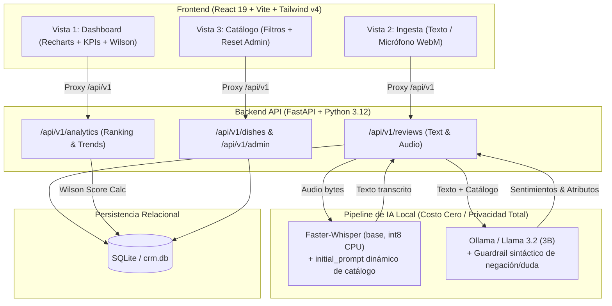

# 🍽️ CRM Gastronómico con IA Local & Wilson Score Interval

Sistema integral de analítica de reseñas y reputación de menú para restaurantes, impulsado por **IA 100% Local y Privada** (Faster-Whisper + Llama 3.2 vía Ollama) y un algoritmo de clasificación estadística robusto basado en **Wilson Score Interval (Lower Bound 95%)**.

---

## 🏛️ Arquitectura del Sistema



---

## 💡 Decisiones Clave de Ingeniería

### 1. ¿Por qué IA 100% Local (Ollama + Faster-Whisper)?
* **Privacidad Absoluta de Comensales:** Las reseñas y grabaciones de audio nunca salen a servidores de terceros (OpenAI, Google o Anthropic), cumpliendo con estándares de privacidad y confidencialidad operativa.
* **Costo Operativo Cero ($0.00 USD por token/llamada):** En la industria restaurantera con márgenes del 5% al 15%, pagar $0.02 USD por reseña o minuto de audio vuelve inviable cualquier solución SaaS tradicional.
* **Inferencia Ligera en CPU:**
  * **Faster-Whisper:** Corre localmente con cuantización `int8` y decodificación nativa PyAV (`av-13.1.0`), procesando audios en <1.5s sin requerir GPU dedicada.
  * **Llama 3.2 (3B):** Modelo compacto ejecutado vía Ollama que extrae esquemas JSON estrictos con latencia de 1 a 2 segundos en CPU.

### 2. ¿Por qué Wilson Score Interval (Lower Bound) en vez de Promedio Simple?
* **El fallo del promedio ingenuo:** Un platillo con 1 reseña de 5 estrellas (100% satisfacción) superaría a un platillo con 80 reseñas positivas y 2 negativas (97.5% satisfacción).
* **Solución Estadística:** Se utiliza el límite inferior del intervalo de confianza binomial de Wilson al 95% ($z = 1.96$):
  $$W_{lb} = \frac{\hat{p} + \frac{z^2}{2n} - z\sqrt{\frac{\hat{p}(1-\hat{p}) + z^2/(4n)}{n}}}{1 + z^2/n}$$
  * Con pocas muestras ($n$ bajo), el intervalo es amplio y el límite inferior $W_{lb}$ es conservador.
  * Conforme se acumulan reseñas consistentes, $W_{lb}$ converge hacia la verdadera satisfacción.
  * Los platillos sin reseñas o con fallos se clasifican con certeza de forma matemática, no arbitraria.

### 3. Sesgo de Vocabulario en STT (`initial_prompt` dinámico)
* Nombres gastronómicos como *"Ribeye a la Parrilla"*, *"Horchata Artesanal"* o *"Sopa Azteca"* sufren alucinaciones fonéticas en modelos de voz estándar.
* El sistema inyecta los nombres de los platillos activos del catálogo como `initial_prompt` en Faster-Whisper, sesgando la probabilidad del beam search hacia el léxico exacto del restaurante.

### 4. Guardrail Híbrido de Negación y Duda
* Los LLMs suelen errar cuando el comensal usa estructuras de negación o exclusión (*"pedí dos tacos que no venían en el menú"*).
* Un motor regex de análisis de cláusulas intercepta el texto antes de la persistencia: si detecta cláusulas de exclusión o duda sobre un platillo, lo reasigna a `"Sin Clasificar"` (preservando la polaridad y atributos) y guarda una justificación trazable (`[Guardrail]`). Además, valida la pertenencia estricta al catálogo oficial.

### 5. Resiliencia de Audio: Trazabilidad de Fallos (`FALLIDO` en HTTP 201)
* Si un comensal graba silencio o ruido ininteligible, el motor STT marca `estado_procesamiento: "FALLIDO"`.
* En lugar de responder con un error `HTTP 500` (que destruiría el evento), el sistema **persiste la reseña con estado FALLIDO** y responde `HTTP 201`. Esto brinda al gerente una métrica real de cuántas interacciones fallaron sin alterar el ranking de cocina.

---

## 🛠️ Stack Tecnológico

| Capa | Tecnología | Justificación |
| :--- | :--- | :--- |
| **Backend** | Python 3.12 + FastAPI | API asíncrona, validación estricta con Pydantic v2 y OpenAPI/Swagger automático. |
| **Persistencia** | SQLite + SQLAlchemy 2.0 | Base relacional embebida sin sobrecarga de configuración para el MVP. |
| **STT (Voz a Texto)** | Faster-Whisper (`base`, int8, CPU) | Inferencia local 4x más rápida que OpenAI Whisper original con mínimo consumo de RAM. |
| **NLP & Entidades** | Ollama (`llama3.2:latest`) | Extracción JSON estructurada de platillos, polaridad (-1 a +1) y atributos. |
| **Frontend** | React 19 + TypeScript + Vite | SPA reactiva con tipado estricto y compilation en <800ms. |
| **Estilos** | Tailwind CSS v4 (`@tailwindcss/vite`) | Diseño moderno sin hojas de estilos CSS infladas. |
| **Visualización** | Recharts | Gráficas SVG reactivas para Leaderboard y distribución de atributos. |
| **Iconos** | Lucide React | Paquete ligero de iconos para métricas, alertas y control de grabación. |

---

## 🚀 Guía de Instalación y Ejecución

### Prerrequisitos Generales
1. **Python 3.11 o 3.12** instalado.
2. **Node.js v18+ y npm** instalados.
3. **Ollama** instalado y con el modelo descargado:
   ```bash
   ollama pull llama3.2:latest
   ```
   > **Nota:** El servicio de Ollama debe estar en ejecución en segundo plano (`http://localhost:11434`, por ejemplo mediante `ollama serve` o la app de Ollama abierta), no en modo chat interactivo.

---

### 🍎 Instrucciones Específicas para macOS (Apple Silicon M1/M2/M3/M4 & Intel)

#### 1. Herramientas del sistema con Homebrew
Si utilizas [Homebrew](https://brew.sh), instala las versiones recomendadas de Python, Node.js y FFmpeg (este último asegura compatibilidad total para procesamiento de formatos de audio):
```bash
brew install python@3.12 node ffmpeg
```

#### 2. Configurar Ollama en macOS
1. Descarga la aplicación nativa para macOS desde [ollama.com/download/mac](https://ollama.com/download/mac) o instálala por Homebrew:
   ```bash
   brew install --cask ollama
   ```
2. Inicia la app de Ollama (se ejecutará como servicio en la barra de menús de macOS).
3. Descarga el modelo Llama 3.2:
   ```bash
   ollama pull llama3.2:latest
   ```

#### 3. Configurar Backend (Uso de Entorno Virtual)
En macOS (especialmente en versiones recientes como Sonoma o Sequoia), Python requiere un entorno virtual para evitar el error `externally-managed-environment`:
```bash
# 1. Crear entorno virtual en la raíz del proyecto
python3 -m venv venv

# 2. Activar entorno virtual
source venv/bin/activate

# 3. Instalar requerimientos del backend
pip install -r backend/requirements.txt

# 4. Iniciar el servidor FastAPI (Puerto 8000)
python3 -m uvicorn app.main:app --host 127.0.0.1 --port 8000 --app-dir backend --reload
```
* Documentación Swagger interactiva: `http://127.0.0.1:8000/docs`

#### 4. Configurar y Ejecutar Frontend
En una segunda terminal:
```bash
# 1. Entrar a la carpeta frontend
cd frontend

# 2. Instalar dependencias
npm install

# 3. Iniciar servidor Vite (Puerto 5173)
npm run dev
```
* Acceder a la aplicación: **`http://localhost:5173`**

> [!TIP]
> **Permisos de Micrófono en macOS**: Al probar la grabación por voz en la vista de **Ingesta**, tu navegador (Chrome, Safari, Arc, Brave) solicitará acceso al micrófono. Si no se habilita la grabación, verifica los permisos en:
> `Ajustes del Sistema > Privacidad y Seguridad > Micrófono` y activa la casilla para tu navegador.

---

### 💻 Instrucciones para Windows / Linux

#### 1. Configurar Backend
```bash
# Instalar dependencias del backend
pip install -r backend/requirements.txt

# Iniciar servidor FastAPI (Puerto 8000)
python -m uvicorn app.main:app --host 127.0.0.1 --port 8000 --app-dir backend --reload
```
* Documentación interactiva Swagger: `http://127.0.0.1:8000/docs`

#### 2. Configurar y Ejecutar Frontend
En una segunda terminal:
```bash
# Entrar a la carpeta frontend
cd frontend

# Instalar dependencias
npm install

# Iniciar servidor de desarrollo Vite (Puerto 5173)
npm run dev
```
* Acceder a la aplicación: **`http://localhost:5173`** *(El proxy en Vite redirige `/api` a FastAPI automáticamente)*.

---

## 🧭 Estructura del Proyecto

```text
CRM/
├── backend/
│   ├── app/
│   │   ├── api/v1/endpoints/   # dishes, reviews, analytics, admin
│   │   ├── core/               # config, database
│   │   ├── db/                 # seed inicial, reset_db
│   │   ├── models/             # Platillo, Resena, TranscripcionAudio, Sentimiento, Atributo
│   │   ├── schemas/            # Schemas Pydantic tipados
│   │   └── services/           # stt_service, nlp_service, ranking_service (Wilson)
│   ├── storage/audios/         # Almacenamiento local de grabaciones de audio
│   └── requirements.txt
├── frontend/
│   ├── src/
│   │   ├── components/         # AudioRecorder, ReviewForm, ReviewResultCard,
│   │   │                       # RankingTable, RankingChart, AttributesChart, RiskAlerts, DishCard
│   │   ├── services/           # api.ts (cliente fetch con proxy)
│   │   ├── types/              # interfaces TypeScript completas
│   │   ├── views/              # DashboardView, IngestaView, MenuView
│   │   ├── App.tsx             # SPA Tab Navigator
│   │   └── main.tsx
│   ├── vite.config.ts          # Proxy /api hacia localhost:8000
│   └── package.json
└── README.md
```

---

## 📊 Endpoints de la API

* `POST /api/v1/reviews/text`: Ingesta y análisis de reseña de texto.
* `POST /api/v1/reviews/upload-audio`: Subida de audio, transcripción local y análisis estructurado.
* `GET /api/v1/reviews/{review_id}`: Consulta detallada de una reseña con su análisis completo de sentimientos y atributos.
* `GET /api/v1/analytics/ranking`: Leaderboard de platillos con Wilson Score Interval y alertas de riesgo.
* `GET /api/v1/analytics/trends`: Tendencias temporales y balance de atributos operativos.
* `GET /api/v1/dishes`: Catálogo activo del menú del restaurante.
* `POST /api/v1/admin/reset-database`: Reinicio limpio de reseñas y sentimientos, preservando el catálogo.
