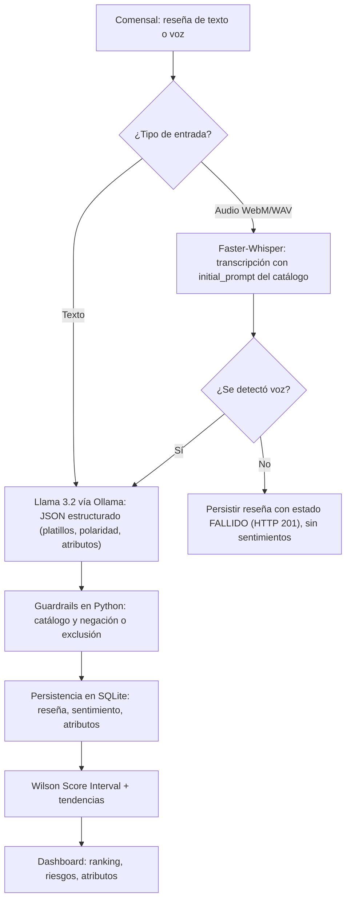
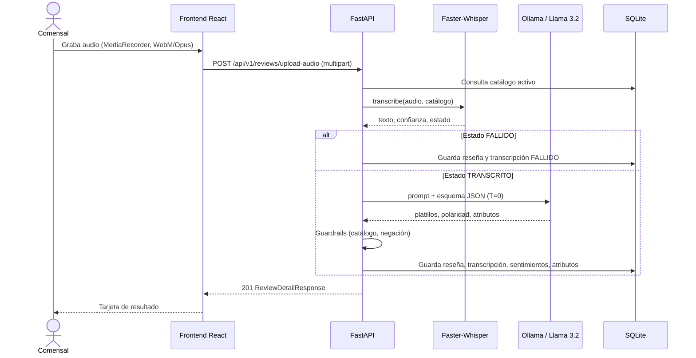
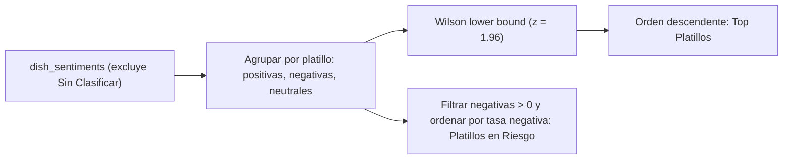

# Investigación: Fundamentos Teóricos del CRM Gastronómico con IA Local y Wilson Score Interval

**Materia:** Tratamiento de la Información
**Proyecto:** CRM Gastronómico con IA Local (Faster-Whisper + Llama 3.2 vía Ollama) y ranking con Wilson Score Interval
**Documento complementario:** [02_Documentacion_Proyecto.md](./02_Documentacion_Proyecto.md)

---

## Índice

1. [Introducción](#1-introducción)
2. [Marco teórico](#2-marco-teórico)
   - [2.1 CRM y analítica de la voz del cliente](#21-crm-y-analítica-de-la-voz-del-cliente)
   - [2.2 Procesamiento de Lenguaje Natural y análisis de sentimiento](#22-procesamiento-de-lenguaje-natural-y-análisis-de-sentimiento)
   - [2.3 Reconocimiento automático de voz (STT)](#23-reconocimiento-automático-de-voz-stt)
   - [2.4 Modelos de lenguaje (LLM) y salida estructurada](#24-modelos-de-lenguaje-llm-y-salida-estructurada)
   - [2.5 Guardrails: control determinista sobre la salida del LLM](#25-guardrails-control-determinista-sobre-la-salida-del-llm)
   - [2.6 Estadística inferencial: Wilson Score Interval](#26-estadística-inferencial-wilson-score-interval)
   - [2.7 Corpus y catálogo cerrado](#27-corpus-y-catálogo-cerrado)
   - [2.8 Almacenamiento de datos](#28-almacenamiento-de-datos)
   - [2.9 Arquitectura de software y API REST](#29-arquitectura-de-software-y-api-rest)
   - [2.10 Desarrollo frontend](#210-desarrollo-frontend)
   - [2.11 IA local frente a IA en la nube: privacidad y costo](#211-ia-local-frente-a-ia-en-la-nube-privacidad-y-costo)
   - [2.12 Validación y pruebas de sistemas con IA](#212-validación-y-pruebas-de-sistemas-con-ia)
3. [Alcance](#3-alcance)
4. [Diagrama](#4-diagrama)
5. [Metodología de desarrollo y uso de herramientas de IA](#5-metodología-de-desarrollo-y-uso-de-herramientas-de-ia)
6. [Conclusiones](#6-conclusiones)
7. [Glosario](#7-glosario)
8. [Referencias](#8-referencias)

---

## 1. Introducción

### 1.1 ¿Qué hace la aplicación?

El proyecto es un **sistema CRM (Customer Relationship Management) especializado en reseñas de restaurantes**. Recibe opiniones de comensales en dos formas, **texto** (por ejemplo, copiado desde Google Maps, TripAdvisor o WhatsApp) y **voz** (grabada desde el navegador). A partir de ellas, el sistema:

1. **Transcribe** el audio a texto (si la reseña es de voz).
2. **Identifica qué platillos del menú se mencionan** y qué opinión se expresa sobre cada uno (positiva, neutral o negativa).
3. **Extrae atributos** de cada mención: temperatura, sabor, porción, textura, precio o presentación.
4. **Guarda** el análisis de forma estructurada en una base de datos relacional.
5. **Calcula un ranking estadísticamente robusto** de platillos y genera alertas de riesgo para el gerente.

El problema que resuelve es que la retroalimentación de los comensales llega como **texto libre no estructurado**. Leerla manualmente no escala, y los promedios simples de estrellas engañan cuando hay pocas reseñas.

### 1.2 Elementos que integran la aplicación

| Elemento | Tecnología / Algoritmo | Función |
|---|---|---|
| Transcripción de voz | **Faster-Whisper** (modelo `base`, cuantización `int8`, CPU) | Convierte audio a texto en español |
| Extracción de entidades y sentimiento | **Llama 3.2 (3B)** ejecutado con **Ollama** | Devuelve JSON estructurado con platillos, polaridad y atributos |
| Control de calidad del LLM | **Guardrails** deterministas en Python | Valida que el platillo pertenezca al catálogo y detecta negaciones o exclusiones |
| Ranking | **Wilson Score Interval** (límite inferior, 95 %) | Ordena platillos considerando la incertidumbre por tamaño de muestra |
| API | **FastAPI** + **Pydantic v2** | Expone los servicios mediante REST y documentación OpenAPI |
| Persistencia | **SQLite** + **SQLAlchemy 2.0** | Almacena reseñas, transcripciones, sentimientos y atributos |
| Interfaz | **React 19** + TypeScript + Vite + Tailwind CSS v4 + Recharts | Ingesta, dashboard y catálogo |

> **Idea central del proyecto:** el LLM *propone* y el código determinista *decide*. La inteligencia artificial se combina con reglas verificables y con estadística inferencial para producir resultados confiables y auditables.

---

## 2. Marco teórico

### 2.1 CRM y analítica de la voz del cliente

**Definición.** Un CRM es un conjunto de estrategias, procesos y sistemas para gestionar la relación con los clientes. Un componente moderno es la **Voz del Cliente (VoC)**: el conjunto de opiniones expresadas por los clientes mediante reseñas, encuestas, llamadas o redes sociales.

**Aplicación en restaurantes.** En gastronomía, la opinión sobre el servicio es inseparable de la opinión sobre **productos concretos** (platillos). Una calificación global de "3 estrellas" no indica *qué* falló. El análisis útil es granular: *"el ribeye llegó frío"* es accionable para cocina, mientras que *"3 estrellas"* no lo es.

**Relación con el proyecto.** El sistema convierte cada reseña en **hechos estructurados** (platillo, polaridad, atributo). Con ellos puede responder consultas operativas como "¿cuántas quejas de temperatura tuvo el Ribeye esta semana?".

### 2.2 Procesamiento de Lenguaje Natural y análisis de sentimiento

**Procesamiento de Lenguaje Natural (PLN o NLP).** Es la rama de la inteligencia artificial que permite a las computadoras analizar y generar lenguaje humano. Las tareas relevantes para este proyecto son:

| Tarea | Descripción | Ejemplo en el proyecto |
|---|---|---|
| **Análisis de sentimiento** | Determinar la polaridad de una opinión (positiva, neutral o negativa) | "estaba delicioso" → positivo |
| **Reconocimiento de entidades (NER)** | Localizar menciones de entidades concretas en el texto | "la sopa azteca" → entidad del catálogo |
| **Vinculación de entidades (entity linking)** | Asociar una mención con un elemento de un catálogo cerrado | "los tacos de barbacoa" → ¿"Tacos de Res Braseada" o "Sin Clasificar"? |
| **Análisis de sentimiento basado en aspectos (ABSA)** | Asociar una polaridad a *aspectos* específicos de una entidad | "carne dura pero buen sabor" → textura(−), sabor(+) |

Liu (2012) describe el análisis de sentimiento como el estudio computacional de opiniones, sentimientos y emociones expresados en texto, y distingue tres niveles de análisis: documento, oración y **aspecto**. La tarea compartida **SemEval-2014 Task 4** (Pontiki et al., 2014) formalizó el ABSA con un conjunto de datos de reseñas de **restaurantes**, el mismo dominio de este proyecto.

**Polaridad numérica.** El sistema convierte la polaridad categórica en un puntaje numérico:

$$
\text{score}(\text{polaridad}) =
\begin{cases}
+1.0 & \text{positivo} \\
0.0 & \text{neutral} \\
-1.0 & \text{negativo}
\end{cases}
$$

**Normalización de texto Unicode.** Antes de comparar cadenas, el proyecto aplica la forma de normalización **NFD** (*Canonical Decomposition*) de Unicode, que separa cada carácter acentuado en la letra base y la marca diacrítica (por ejemplo, `é` pasa a `e` + `´`). Después elimina las marcas (categoría Unicode `Mn`). Así, "frío", "frio" y "FRÍO" se comparan como iguales, lo que da robustez frente a transcripciones sin tildes. Este paso lo realiza la función `_normalize_text` del servicio de NLP.

### 2.3 Reconocimiento automático de voz (STT)

**Definición.** El reconocimiento automático de voz (*Automatic Speech Recognition*, ASR, o *Speech-to-Text*, STT) transforma una señal de audio en texto.

#### 2.3.1 Whisper

Whisper es un modelo de OpenAI entrenado con **680 000 horas de audio multilingüe y multitarea** supervisado de manera débil (*weak supervision*), tomado de internet (Radford et al., 2022). Su arquitectura es un **Transformer codificador-decodificador** (Vaswani et al., 2017):

- El **codificador** recibe un espectrograma log-Mel del audio y produce una representación contextual.
- El **decodificador** genera el texto token por token, de forma autorregresiva y condicionado por esa representación y por tokens especiales (idioma, tarea).

Whisper puede transcribir, detectar el idioma y traducir. Su principal virtud es la **generalización *zero-shot***: funciona razonablemente bien sin ajuste fino para cada dominio.

| Modelo | Tamaño relativo | Uso típico |
|---|---|---|
| `tiny` / `base` | Pequeño | Baja latencia, hardware limitado (**`base` usado en el proyecto**) |
| `small` / `medium` | Medio | Mayor precisión, más RAM y tiempo |
| `large` | Grande | Máxima precisión, requiere GPU |

#### 2.3.2 Faster-Whisper y CTranslate2

**Faster-Whisper** (SYSTRAN, s. f.) es una reimplementación de Whisper sobre **CTranslate2**, un motor de inferencia optimizado para Transformers. Según sus autores, logra velocidades de hasta 4 veces las de la implementación original con menor consumo de memoria. El proyecto lo ejecuta en **CPU** con `compute_type="int8"`.

#### 2.3.3 Cuantización

La **cuantización** reduce la precisión numérica de los pesos y las activaciones (por ejemplo, de 32 bits de punto flotante a enteros de 8 bits). Jacob et al. (2018) demuestran que la inferencia solo con aritmética entera reduce el uso de memoria y mejora la latencia con una pérdida de exactitud pequeña.

$$
\text{memoria}_{int8} \approx \tfrac{1}{4}\,\text{memoria}_{fp32}
$$

#### 2.3.4 Parámetros de decodificación usados

| Parámetro | Valor en el proyecto | Significado |
|---|---|---|
| `language` | `"es"` | Fuerza el idioma español y evita la detección automática |
| `beam_size` | `1` | Equivale a búsqueda voraz (*greedy*). Prioriza velocidad en CPU. Un valor mayor explora más hipótesis |
| `vad_filter` | `True` | *Voice Activity Detection*: descarta segmentos sin voz |
| `initial_prompt` | Vocabulario del menú | Sesga la decodificación hacia términos esperados |

**Beam search.** Es un algoritmo de búsqueda heurística que, en cada paso de generación, conserva las *k* hipótesis más probables (*k* = `beam_size`). Con *k* = 1 se reduce a una búsqueda voraz: es más rápida, pero puede perder transcripciones globalmente mejores.

**`initial_prompt` y sesgo de vocabulario.** Whisper condiciona su decodificación con el texto previo. Al inyectar `"Vocabulario esperado del restaurante y menú: Sopa Azteca, Ribeye a la Parrilla, ..."`, aumenta la probabilidad de producir esos términos exactos. Esto mitiga errores fonéticos con nombres propios o extranjerismos, como *Ribeye*.

**Confianza de la transcripción.** Cada segmento de Whisper reporta un `avg_logprob` (logaritmo promedio de la probabilidad de los tokens). El proyecto lo convierte en una aproximación de probabilidad entre 0 y 1:

$$
\text{confianza}_{segmento} = \min\!\big(\max(e^{\,\text{avg\_logprob}},\,0),\,1\big),
\qquad
\text{confianza}_{audio} = \frac{1}{m}\sum_{i=1}^{m}\text{confianza}_i
$$

> **Nota técnica.** `exp(avg_logprob)` equivale a la media geométrica de las probabilidades por token. Es una **heurística de confianza**, no una probabilidad calibrada de que el texto sea correcto.

#### 2.3.5 Captura de audio en el navegador

El frontend usa la **API MediaRecorder** del navegador (MDN Web Docs, s. f.) para grabar desde el micrófono en formato **WebM con códec Opus**, con *fallback* a `audio/webm` y `audio/mp4`. El backend decodifica estos contenedores con **PyAV** (bindings de FFmpeg), sin necesidad de convertir el archivo manualmente.

### 2.4 Modelos de lenguaje (LLM) y salida estructurada

#### 2.4.1 Transformers y LLM

Un **modelo de lenguaje de gran escala (LLM)** es una red neuronal profunda, casi siempre basada en la arquitectura **Transformer**, entrenada para predecir el siguiente token de una secuencia. El Transformer reemplaza la recurrencia por **autoatención** (*self-attention*), que pondera la relevancia de cada token respecto a todos los demás (Vaswani et al., 2017):

$$
\text{Attention}(Q,K,V)=\text{softmax}\!\left(\frac{QK^{\top}}{\sqrt{d_k}}\right)V
$$

Con ella el modelo captura dependencias de largo alcance y puede entrenarse en paralelo. La **complejidad temporal de la autoatención** es $O(n^2 \cdot d)$ para una secuencia de longitud $n$. Por eso se prefieren textos cortos, como las reseñas, para mantener una latencia baja en CPU.

#### 2.4.2 Llama 3 y Llama 3.2

**Llama 3** es la familia de LLM abiertos de Meta, basada en Transformers densos y entrenada con aproximadamente 15 billones de tokens multilingües (Grattafiori et al., 2024). **Llama 3.2** añadió modelos ligeros de solo texto de **1B y 3B parámetros**, pensados para dispositivos de borde. Usan *Grouped-Query Attention* y soportan contexto de 128 000 tokens (Meta AI, 2024). El proyecto emplea `llama3.2:latest`, que corresponde al modelo de ~3B parámetros.

| Característica | Valor |
|---|---|
| Parámetros | ~3 mil millones |
| Modalidad | Texto |
| Idiomas oficialmente soportados | Incluye español |
| Ejecución | Local, en CPU o GPU, mediante Ollama |

#### 2.4.3 Ollama e inferencia local

**Ollama** es un entorno que descarga, gestiona y sirve LLM abiertos mediante una API HTTP local (por defecto `http://localhost:11434`). Soporta modelos cuantizados, de modo que un modelo de 3B ocupa pocos GB y corre en hardware de consumo.

#### 2.4.4 Salida estructurada con JSON Schema

Un LLM genera texto libre, lo cual es difícil de integrar con un sistema de software. La **salida estructurada** restringe la generación para que cumpla un **esquema JSON**. Ollama lo permite con el parámetro `format`, que aplica *constrained decoding* (decodificación restringida) a nivel de token (Ollama, 2024). En el proyecto:

1. Se define el esquema con **Pydantic** (`AnalisisResenaLLM`).
2. Se exporta con `model_json_schema()` y se pasa a Ollama.
3. La respuesta se valida con `model_validate_json()`.

El esquema de extracción es:

```text
AnalisisResenaLLM
└── platillos: List[PlatilloExtraidoLLM]
      ├── texto_mencionado   (str)   fragmento literal de la reseña
      ├── platillo_sugerido  (str)   nombre del catálogo o "Sin Clasificar"
      ├── polaridad          (enum)  positivo | neutral | negativo
      └── atributos          (List[str]) cualidades o quejas mencionadas
```

#### 2.4.5 Temperatura y determinismo

La **temperatura** controla la aleatoriedad del muestreo. Con $T=0$ el modelo selecciona siempre el token más probable (decodificación voraz), lo que hace que la salida sea **reproducible**. El proyecto usa `temperature: 0.0` para obtener resultados consistentes entre ejecuciones. Esto es importante en un sistema de analítica, donde la misma reseña debe producir siempre el mismo resultado.

#### 2.4.6 Alucinaciones y vinculación a catálogo cerrado

Un LLM puede **alucinar**: generar información plausible pero falsa, como inventar un platillo que no existe en el menú. Las mitigaciones del proyecto son:

- Incluir el **catálogo oficial** dentro del *prompt* como lista cerrada.
- Instruir explícitamente: *"NO inventes ningún nombre fuera del catálogo"*, con la categoría de escape `"Sin Clasificar"`.
- Verificar la respuesta con código determinista (siguiente sección).

### 2.5 Guardrails: control determinista sobre la salida del LLM

**Definición.** Un *guardrail* es una capa de reglas explícitas, externa al modelo, que valida o corrige su salida antes de que tenga efectos en el sistema. Se justifica porque los LLM pequeños son buenos *proponiendo* pero no son 100 % fiables *decidiendo* con reglas estrictas.

El proyecto implementa dos guardrails en `_apply_guardrails`:

| # | Guardrail | Regla | Efecto |
|---|---|---|---|
| 1 | **Pertenencia al catálogo** | Si `platillo_sugerido` no está en el catálogo oficial y no es `"Sin Clasificar"` | Reasigna a `"Sin Clasificar"` |
| 2 | **Negación / exclusión / duda** | Si en la mención o en su cláusula aparece una palabra clave como `"no venía"`, `"no era"`, `"en vez de"`, `"diferente"`, etc. | Reasigna a `"Sin Clasificar"` y guarda la justificación `[Guardrail] ...` |

**Segmentación en cláusulas.** Para el guardrail 2, el texto normalizado se divide en cláusulas con la expresión regular `[,.;\n]|\bpero\b|\baunque\b|\bsin embargo\b|\bademas\b`. Solo si la palabra clave aparece en una cláusula que *también* contiene palabras de la mención del platillo, se activa la regla. Así se evita que una negación sobre otro platillo contamine al platillo actual.

**Fundamento.** Es una aplicación del principio de **sistemas híbridos neuro-simbólicos**: la parte estadística (LLM) aporta flexibilidad lingüística, y la parte simbólica (reglas) aporta garantías verificables y trazabilidad.

> **Limitación conocida.** Las listas de palabras clave son una aproximación. Incluyen términos muy generales (`otro`, `otra`, `diferente`) que pueden producir falsos positivos, y frases de negación indirecta pueden escaparse. Ver el documento de proyecto, sección de limitaciones.

### 2.6 Estadística inferencial: Wilson Score Interval

Este es el núcleo estadístico del proyecto. Responde a la pregunta *"¿cómo ordenar platillos cuando algunos tienen pocas reseñas?"*.

#### 2.6.1 El problema del promedio simple

Si se ordena por proporción de reseñas positivas $\hat p = x/n$:

| Platillo | Positivas $x$ | Total $n$ | $\hat p$ |
|---|---|---|---|
| A | 1 | 1 | **100 %** |
| B | 80 | 82 | 97.6 % |

El platillo A quedaría primero con una sola opinión, lo cual es estadísticamente injustificado. El promedio ignora la **incertidumbre** asociada al tamaño de muestra (Miller, 2009).

#### 2.6.2 Modelo binomial

Cada mención se modela como un ensayo de Bernoulli (positiva = éxito, otra = fracaso). El número de menciones positivas $X$ en $n$ ensayos sigue una **distribución binomial** $X\sim\text{Bin}(n,p)$, con $p$ la verdadera tasa de satisfacción, desconocida. Se estima $\hat p = X/n$ y se desea un **intervalo de confianza** para $p$.

#### 2.6.3 Intervalo de Wald (aproximación ingenua)

El intervalo clásico (de Wald) es:

$$
\hat p \pm z\sqrt{\frac{\hat p(1-\hat p)}{n}}
$$

Presenta problemas graves para $n$ pequeño o $\hat p$ cercano a 0 o 1: puede salirse de $[0,1]$ y, si $\hat p = 1$, produce un intervalo de ancho cero (certeza injustificada). Brown, Cai y DasGupta (2001) documentan que su cobertura real es deficiente y recomiendan alternativas como Wilson.

#### 2.6.4 Intervalo de Wilson

Wilson (1927) propone **invertir la prueba de hipótesis** usando el error estándar bajo el valor *verdadero* $p$ y no el estimado. Se parte de:

$$
\left|\hat p - p\right| \le z\sqrt{\frac{p(1-p)}{n}}
$$

Al elevar al cuadrado y resolver la desigualdad cuadrática en $p$ se obtiene:

$$
p \in \frac{\hat p + \dfrac{z^2}{2n} \;\pm\; z\sqrt{\dfrac{\hat p(1-\hat p)}{n} + \dfrac{z^2}{4n^2}}}{1 + \dfrac{z^2}{n}}
$$

El **límite inferior** es el valor que usa el proyecto:

$$
\boxed{W_{lb} = \frac{\hat p + \dfrac{z^2}{2n} - z\sqrt{\dfrac{\hat p(1-\hat p) + \dfrac{z^2}{4n}}{n}}}{1 + \dfrac{z^2}{n}}}
\qquad z = 1.96 \;(95\,\%)
$$

El proyecto implementa exactamente esta forma en `wilson_score_lower_bound(positives, total, z=1.96)`. Si $n=0$ devuelve 0.

#### 2.6.5 Propiedades

- **Siempre cae en $[0,1]$.**
- **Conservador con pocas muestras:** el intervalo es ancho y el límite inferior es bajo.
- **Converge a $\hat p$ cuando $n\to\infty$.**
- **Premia la consistencia a gran volumen:** más evidencia estrecha el intervalo.
- **Complejidad:** $O(1)$ por platillo, con costo total $O(N)$ sobre las $N$ menciones agrupadas.

#### 2.6.6 Ejemplos numéricos (calculados con la implementación del proyecto)

| Positivas | Total | $\hat p$ | $W_{lb}$ (95 %) |
|---|---|---|---|
| 1 | 1 | 1.000 | **0.2065** |
| 2 | 2 | 1.000 | **0.3424** |
| 10 | 10 | 1.000 | 0.7225 |
| 100 | 100 | 1.000 | 0.9630 |
| 80 | 82 | 0.976 | **0.9154** |
| 0 | 1 | 0.000 | 0.0000 |
| 1 | 2 | 0.500 | 0.0945 |

Con Wilson, el platillo "1 de 1" (0.2065) queda **muy por debajo** del platillo "80 de 82" (0.9154), lo opuesto al promedio simple. Los valores 0.2065 y 0.3424 coinciden con los resultados reales del benchmark del proyecto.

#### 2.6.7 Alternativas consideradas

| Método | Ventaja | Inconveniente |
|---|---|---|
| Promedio simple | Trivial | Ignora el tamaño de muestra |
| Media bayesiana con factor de penalización (probada y descartada) | Considera el volumen | Penalizaba dos veces las reseñas negativas y producía órdenes sin sentido comercial, según la documentación del proyecto |
| Intervalo de Wald | Fórmula simple | Cobertura deficiente con $n$ pequeño |
| **Wilson (elegido)** | Robusto con $n$ pequeño, cerrado, $O(1)$ | Trata cada mención como binaria (positiva o no) |

> **Decisión de diseño.** Para el ranking, una mención *neutral* cuenta como "no positiva". La tasa negativa se reporta aparte (`tasa_negativa`) para la lista de **Platillos en Riesgo**.

#### 2.6.8 Tendencias temporales

El sistema también compara el puntaje medio de polaridad de una ventana reciente contra la previa:

$$
\Delta = \bar s_{reciente} - \bar s_{previo}
\qquad
\text{tendencia}=
\begin{cases}
\text{MEJORANDO} & \Delta \ge 0.15\\
\text{EMPEORANDO} & \Delta \le -0.15\\
\text{ESTABLE} & \text{en otro caso}\\
\text{SIN\_DATOS\_PREVIOS} & \text{si no hay menciones previas}
\end{cases}
$$

Se trata de una **diferencia de medias con umbral fijo (±0.15)** y no de una prueba de significancia estadística. Es una heurística descriptiva.

### 2.7 Corpus y catálogo cerrado

**Corpus.** Un corpus es una colección estructurada de textos (o audios) usada para entrenar, ajustar o evaluar modelos lingüísticos. Se caracteriza por su dominio, tamaño, idioma y anotación.

**En este proyecto no se entrena ningún modelo.** Los modelos Whisper y Llama están **preentrenados**. Por eso el término *corpus* se aplica en tres sentidos:

| Concepto | Descripción | Rol |
|---|---|---|
| **Corpus de preentrenamiento (externo)** | 680 000 h de audio (Whisper) y ~15 billones de tokens (Llama 3) | Origen de las capacidades de los modelos; no se redistribuye |
| **Catálogo cerrado (ontología del dominio)** | 7 platillos oficiales con nombre, categoría, descripción, precio y estado activo | Vocabulario controlado para el *entity linking* y para el `initial_prompt` |
| **Corpus de validación** | Conjunto pequeño de reseñas de texto y audios `.wav` creados por el equipo | Medir consistencia y casos límite (ver sección 2.12) |

**Catálogo cerrado.** Es una lista finita y autorizada de entidades válidas. Su uso reduce el problema de vinculación a *clasificación sobre un conjunto conocido más una clase de rechazo* (`"Sin Clasificar"`). Es más manejable y verificable que la extracción abierta de entidades.

### 2.8 Almacenamiento de datos

#### 2.8.1 Modelo relacional

El **modelo relacional** (Codd, 1970) organiza los datos en relaciones (tablas) con filas y columnas, y los vincula mediante claves. Sus conceptos principales son:

| Concepto | Descripción | Ejemplo en el proyecto |
|---|---|---|
| Clave primaria (PK) | Identifica de forma única cada fila | `id` (UUID de 36 caracteres) |
| Clave foránea (FK) | Referencia a la PK de otra tabla | `dish_sentiments.resena_id → reviews.id` |
| Cardinalidad 1:1 | Una fila se asocia con una sola | `reviews` ↔ `audio_transcriptions` |
| Cardinalidad 1:N | Una fila se asocia con muchas | `reviews` → `dish_sentiments` |
| Integridad referencial | La FK siempre apunta a una fila existente | `ON DELETE CASCADE` / `SET NULL` |

**Normalización.** Es el proceso de organizar las tablas para reducir la redundancia. Aquí, una reseña con varios platillos y cada platillo con varios atributos se separa en cuatro tablas, en lugar de guardar todo como texto en una sola. Esto permite consultas analíticas directas (por ejemplo, "quejas de temperatura de la última semana") sin volver a procesar texto libre.

#### 2.8.2 SQL y ORM

**SQL** es el lenguaje declarativo estándar de las bases relacionales. Un **ORM** (*Object-Relational Mapper*) como **SQLAlchemy** mapea tablas a clases de Python, y permite construir consultas con objetos y no con cadenas SQL. El proyecto usa el estilo declarativo de SQLAlchemy 2.0.

#### 2.8.3 SQLite frente a PostgreSQL

| Criterio | SQLite (usado) | PostgreSQL |
|---|---|---|
| Arquitectura | Embebida, un único archivo | Cliente/servidor |
| Configuración | Ninguna | Instalación y administración |
| Escrituras concurrentes | **Un solo escritor a la vez** | Concurrencia fina por filas (MVCC) |
| Escalabilidad | Baja y media | Alta |
| Adecuación | Prototipos, MVP, aplicaciones locales | Producción multiusuario |

La documentación oficial de SQLite indica que admite lectores simultáneos ilimitados pero solo un escritor en cada instante, y que para cargas de escritura concurrente intensa suele ser mejor un SGBD cliente/servidor (SQLite, s. f.). Para el alcance del proyecto (un MVP de clase) SQLite es adecuado, y SQLAlchemy permite migrar a PostgreSQL cambiando principalmente la cadena de conexión.

#### 2.8.4 Transacciones y atomicidad

La función de persistencia usa `flush()` para obtener el identificador de la reseña y un único `commit()` al final. Así, la reseña, su transcripción, sus sentimientos y sus atributos se guardan **de forma atómica**: o se guardan todos o ninguno (propiedad *Atomicity* de ACID).

### 2.9 Arquitectura de software y API REST

#### 2.9.1 Arquitectura en capas

El backend separa responsabilidades en capas, lo que mejora la mantenibilidad y la capacidad de prueba:

| Capa | Responsabilidad | Carpeta |
|---|---|---|
| Presentación (API) | Recibe peticiones HTTP y valida entradas | `api/v1/endpoints/` |
| Esquemas | Contratos de datos de entrada y salida | `schemas/` |
| Servicios (lógica de negocio) | STT, NLP y ranking | `services/` |
| Persistencia | Modelos ORM y sesión de base de datos | `models/`, `core/database.py` |

#### 2.9.2 REST

**REST** (*Representational State Transfer*) es un estilo arquitectónico para sistemas distribuidos descrito por Fielding (2000). Sus restricciones incluyen la interfaz uniforme, la ausencia de estado entre peticiones, el modelo cliente-servidor y la cacheabilidad. El proyecto expone recursos bajo `/api/v1/` con verbos HTTP (`GET`, `POST`) y códigos de estado semánticos (`201 Created`, `404 Not Found`).

#### 2.9.3 FastAPI, Pydantic y OpenAPI

- **FastAPI** es un marco web asíncrono de Python basado en *type hints*. Genera automáticamente la documentación **OpenAPI/Swagger** (`/docs`).
- **Pydantic v2** valida y serializa datos con modelos tipados. Aquí se usa en dos lugares: validar peticiones y respuestas HTTP, y validar la salida del LLM.
- **CORS** (*Cross-Origin Resource Sharing*) permite que el navegador acepte respuestas de otro origen. El backend lo habilita con `allow_origins=["*"]`, apropiado para desarrollo pero no para producción.
- **Versionado de API** (`/api/v1`) permite evolucionar sin romper clientes.

#### 2.9.4 Procesamiento síncrono y asíncrono

Las rutas de texto son funciones síncronas (FastAPI las ejecuta en un *thread pool*). La ruta de audio es `async`, pero la inferencia de Whisper y Ollama es bloqueante y se ejecuta dentro del *request*. Para volúmenes altos convendría desacoplar el procesamiento con una cola de tareas (ver trabajo futuro).

### 2.10 Desarrollo frontend

| Tecnología | Descripción | Uso en el proyecto |
|---|---|---|
| **SPA** (*Single Page Application*) | Una sola página que actualiza su contenido sin recargar | Navegación por pestañas |
| **React 19** | Biblioteca de interfaces basada en componentes y estado | Vistas y componentes |
| **TypeScript** | JavaScript con tipado estático | Interfaces espejo de los esquemas del backend |
| **Vite** | Servidor de desarrollo y empaquetador rápido; actúa como *proxy* de `/api` hacia el backend | `vite.config.ts` |
| **Tailwind CSS v4** | CSS utilitario | Estilos |
| **Recharts** | Gráficas SVG declarativas para React | Ranking y distribución de atributos |
| **Lucide React** | Iconos | Interfaz |
| **MediaRecorder API** | Grabación de audio del navegador | `AudioRecorder` |

**Proxy de desarrollo.** Vite redirige `/api` hacia `http://127.0.0.1:8000`, de modo que el navegador percibe un único origen y se evitan problemas de CORS durante el desarrollo.

### 2.11 IA local frente a IA en la nube: privacidad y costo

| Criterio | IA local (este proyecto) | API en la nube |
|---|---|---|
| Privacidad | Las reseñas y los audios **no salen** del equipo | Los datos se envían a un tercero |
| Costo marginal | Sin cargo por llamada (solo hardware y electricidad) | Se cobra por token o por minuto de audio |
| Latencia | Depende del hardware local (~1–2 s en CPU según la documentación del proyecto) | Depende de la red |
| Calidad del modelo | Menor (modelos pequeños) | Mayor (modelos de frontera) |
| Disponibilidad | Funciona sin internet | Requiere conexión |
| Mantenimiento | Lo asume el operador | Lo asume el proveedor |

**Justificación.** En restaurantes, los márgenes son estrechos y el volumen de reseñas es bajo o moderado, de modo que el costo por llamada y la privacidad de los comensales pesan más que la última fracción de exactitud. El trade-off asumido es una menor calidad del modelo, compensada con guardrails y validación.

### 2.12 Validación y pruebas de sistemas con IA

Los sistemas con IA generativa requieren estrategias de prueba distintas de las del software determinista. El proyecto aplica las siguientes:

| Tipo de prueba | Objetivo | Ejemplo en el proyecto |
|---|---|---|
| **Consistencia** (repetibilidad) | Verificar que la misma entrada produce la misma salida | 3 corridas idénticas con `temperature=0` (`verify_fix_consistency.py`) |
| **Casos límite** | Probar entradas difíciles | Negación ("no venían en el menú"), ambigüedad, audio silencioso |
| **Validación de esquema** | Comprobar que la salida cumple el contrato | `AnalisisResenaLLM.model_validate_json` |
| **Pruebas de extremo a extremo** | Verificar la cadena completa | `test_api_endpoints.py` con `TestClient` |
| **Benchmark reproducible** | Repetir el experimento sobre una base limpia | `run_clean_benchmark.py` + endpoint de reinicio |
| **Regresión** | Confirmar que una corrección no rompe un caso anterior | `check_guardrail_regression.py` |

**Resiliencia ante fallos (*graceful degradation*).** Si el STT no detecta voz, el sistema no responde con error `500`. Persiste la reseña con `estado_procesamiento = "FALLIDO"` y responde `201`, lo que preserva la trazabilidad operativa sin afectar el ranking.

---

## 3. Alcance

### 3.1 Qué hace la aplicación al final

- **Ingesta multimodal:** reseñas de texto (con canal de origen, autor y calificación opcional de 1 a 5) y reseñas de voz (grabación en el navegador o carga de archivo).
- **Transcripción local** del audio, con vocabulario del menú inyectado y medida de confianza.
- **Extracción estructurada** de platillos, polaridad y atributos, vinculados a un catálogo de 7 platillos o a `"Sin Clasificar"`.
- **Guardrails** de pertenencia al catálogo y de negación o exclusión, con justificación trazable.
- **Persistencia relacional** de reseñas, transcripciones, sentimientos y atributos.
- **Dashboard gerencial:** ranking por Wilson Score, platillos en riesgo, gráfica de ranking y distribución de atributos.
- **Tendencias** por platillo (ventana reciente frente a previa) y atributos globales.
- **Catálogo con filtros por categoría** y **reinicio administrativo** de la base de datos (conserva el catálogo).

### 3.2 Fuera de alcance

| No incluido | Comentario |
|---|---|
| Autenticación y roles | Los endpoints, incluido el de reinicio, no están protegidos |
| Alta, edición y baja de platillos desde la interfaz | El catálogo se siembra desde código |
| Pruebas de carga y concurrencia | No se realizaron |
| Entrenamiento o ajuste fino de modelos | Solo se usan modelos preentrenados |
| Análisis de otros idiomas o dialectos | Se fuerza `language="es"` |
| Despliegue en producción | Es un MVP de validación de concepto |

---

## 4. Diagrama

### 4.1 Flujo general del sistema



### 4.2 Secuencia de una reseña de voz



### 4.3 Flujo del ranking



---

## 5. Metodología de desarrollo y uso de herramientas de IA

El proyecto se construyó con apoyo de herramientas de IA, y esto se declara de forma explícita:

- **Agente de codificación:** Google Antigravity, que generó gran parte del código.
- **Revisión:** Claude, usado como revisor de cada entrega antes de aprobarla.
- **Rol del autor humano:** definir el diseño, validar con datos reales y rechazar versiones cuando los resultados no cuadraban (por ejemplo, un ranking con números que no correspondían al dataset, o un plan que se reportaba como ejecutado sin evidencia).
- **Ejemplo de decisión validada empíricamente:** la fórmula inicial (media bayesiana con factor de penalización) se **descartó** tras detectar con datos reales que penalizaba dos veces las reseñas negativas, y se sustituyó por Wilson.

Esta metodología implica que la responsabilidad del autor es **comprender y verificar** lo producido, por lo que el proyecto incluye scripts de validación reproducibles.

---

## 6. Conclusiones

### 6.1 Lo más difícil y cómo se resolvió

| Dificultad | Solución adoptada |
|---|---|
| Un LLM pequeño (3B) asigna platillos del catálogo aunque el texto diga que no estaban en el menú | Guardrail determinista de negación y exclusión por cláusulas |
| Whisper deforma nombres propios (por ejemplo, "Sopa Azteca" se transcribe como "sopasteca") | `initial_prompt` dinámico con el catálogo; la documentación del proyecto reporta una mejora de confianza de ~73 % a ~85–90 % |
| Resultados no reproducibles del LLM | `temperature = 0` y salida restringida por JSON Schema |
| Un ranking que favorece platillos con una sola reseña | Wilson Score Interval (límite inferior) |
| Audio sin voz que podía romper el flujo | Estado `FALLIDO` con respuesta `201` y trazabilidad |
| Repetir experimentos con números limpios | Endpoint de reinicio que borra reseñas y conserva el catálogo |

### 6.2 Conclusiones generales

1. **La combinación híbrida funciona:** el LLM aporta comprensión del lenguaje natural y el código determinista aporta fiabilidad verificable.
2. **La estadística importa tanto como la IA:** el ranking depende más de la elección del estimador (Wilson) que de la exactitud marginal del modelo.
3. **IA local es viable** para un caso de uso de volumen bajo o moderado, con costo por llamada nulo y privacidad total, a cambio de menor calidad de modelo.
4. **La validación empírica evitó errores de diseño** (la fórmula descartada es un ejemplo).
5. **Un MVP honesto** documenta sus limitaciones: lista de palabras clave limitada, ausencia de pruebas de concurrencia y de autenticación.

### 6.3 Propuestas a futuro

- Migrar a **PostgreSQL** y procesar el pipeline de IA en **tareas asíncronas** (cola de trabajos).
- Evaluar modelos mayores (por ejemplo, Whisper `small` o un LLM de más parámetros) con un corpus de validación más amplio y etiquetado manualmente, para medir **precisión, exhaustividad y F1**.
- Sustituir la lista de palabras clave del guardrail por un clasificador de negación más robusto.
- Añadir **autenticación**, administración del catálogo y exportación de reportes.
- Incorporar **intervalos de confianza** para las tendencias en lugar de umbrales fijos.
- Ampliar a otros dominios donde importe la reputación con pocos datos: hoteles, tiendas, soporte técnico, educación (evaluación docente).

---

## 7. Glosario

| Término | Definición |
|---|---|
| **ABSA** | *Aspect-Based Sentiment Analysis*: sentimiento por aspecto o atributo |
| **API REST** | Interfaz de servicios web basada en HTTP y recursos |
| **ASR / STT** | Reconocimiento automático de voz / voz a texto |
| **Beam search** | Búsqueda heurística que conserva las *k* mejores hipótesis |
| **CORS** | Mecanismo del navegador para peticiones entre orígenes |
| **Corpus** | Colección estructurada de textos o audios |
| **Cuantización** | Reducción de la precisión numérica de un modelo |
| **Guardrail** | Regla externa que valida o corrige la salida de un modelo |
| **initial_prompt** | Texto previo que sesga la decodificación de Whisper |
| **Intervalo de confianza** | Rango de valores plausibles para un parámetro |
| **LLM** | *Large Language Model*: modelo de lenguaje de gran escala |
| **ORM** | Mapeo objeto-relacional |
| **Polaridad** | Orientación de una opinión (positiva, neutral o negativa) |
| **SPA** | Aplicación de una sola página |
| **Temperatura** | Parámetro de aleatoriedad del muestreo de un LLM |
| **VAD** | *Voice Activity Detection*: detección de actividad de voz |
| **Wilson Score** | Intervalo de confianza para una proporción binomial |

---

## 8. Referencias

Brown, L. D., Cai, T. T., & DasGupta, A. (2001). Interval estimation for a binomial proportion. *Statistical Science, 16*(2), 101–133. https://doi.org/10.1214/ss/1009213286

Codd, E. F. (1970). A relational model of data for large shared data banks. *Communications of the ACM, 13*(6), 377–387.

Fielding, R. T. (2000). *Architectural styles and the design of network-based software architectures* [Tesis doctoral, University of California, Irvine].

Grattafiori, A., Dubey, A., Jauhri, A., Pandey, A., Kadian, A., Al-Dahle, A., et al. (2024). *The Llama 3 herd of models*. arXiv. https://arxiv.org/abs/2407.21783

Jacob, B., Kligys, S., Chen, B., Zhu, M., Tang, M., Howard, A., Adam, H., & Kalenichenko, D. (2018). Quantization and training of neural networks for efficient integer-arithmetic-only inference. En *Proceedings of the IEEE Conference on Computer Vision and Pattern Recognition (CVPR)* (pp. 2704–2713).

Liu, B. (2012). *Sentiment analysis and opinion mining*. Synthesis Lectures on Human Language Technologies, 5(1). Morgan & Claypool. https://doi.org/10.2200/S00416ED1V01Y201204HLT016

Meta AI. (2024). *Llama 3.2: Revolutionizing edge AI and vision with open, customizable models* [Entrada de blog]. https://ai.meta.com/blog/llama-3-2-connect-2024-vision-edge-mobile-devices/

Miller, E. (2009). *How not to sort by average rating*. https://www.evanmiller.org/how-not-to-sort-by-average-rating.html

MDN Web Docs. (s. f.). *MediaRecorder*. Mozilla. https://developer.mozilla.org/en-US/docs/Web/API/MediaRecorder

Ollama. (2024). *Structured outputs*. https://ollama.com/blog/structured-outputs

Pontiki, M., Galanis, D., Pavlopoulos, J., Papageorgiou, H., Androutsopoulos, I., & Manandhar, S. (2014). SemEval-2014 Task 4: Aspect based sentiment analysis. En *Proceedings of the 8th International Workshop on Semantic Evaluation (SemEval 2014)* (pp. 27–35). Association for Computational Linguistics. https://doi.org/10.3115/v1/S14-2004

Radford, A., Kim, J. W., Xu, T., Brockman, G., McLeavey, C., & Sutskever, I. (2022). *Robust speech recognition via large-scale weak supervision*. arXiv. https://arxiv.org/abs/2212.04356

SQLite. (s. f.). *Appropriate uses for SQLite*. https://www.sqlite.org/whentouse.html

SYSTRAN. (s. f.). *faster-whisper* [Repositorio de software]. GitHub. https://github.com/SYSTRAN/faster-whisper

Vaswani, A., Shazeer, N., Parmar, N., Uszkoreit, J., Jones, L., Gomez, A. N., Kaiser, Ł., & Polosukhin, I. (2017). Attention is all you need. En *Advances in Neural Information Processing Systems 30 (NeurIPS 2017)*.

Wilson, E. B. (1927). Probable inference, the law of succession, and statistical inference. *Journal of the American Statistical Association, 22*(158), 209–212. https://doi.org/10.2307/2276774

*Documentación oficial consultada:* FastAPI (https://fastapi.tiangolo.com/), SQLAlchemy 2.0 (https://docs.sqlalchemy.org/en/20/), Pydantic (https://docs.pydantic.dev/latest/).
