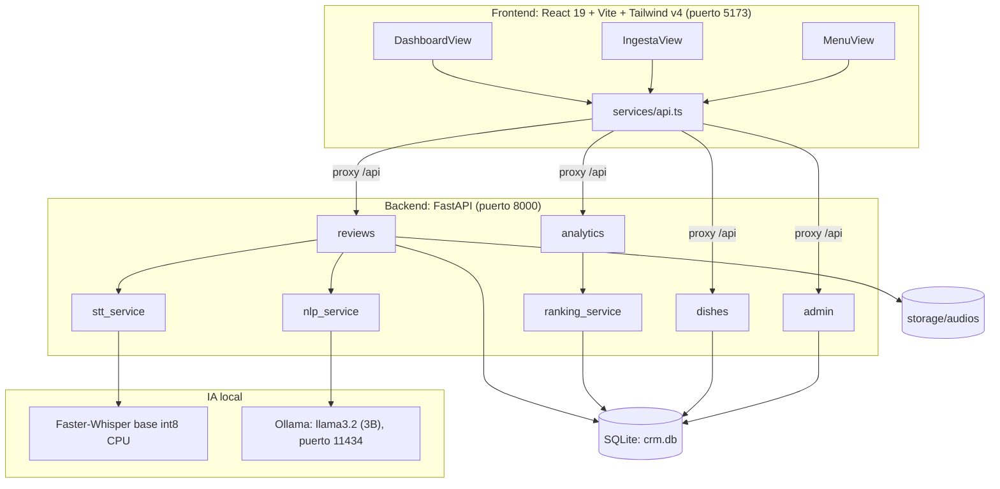
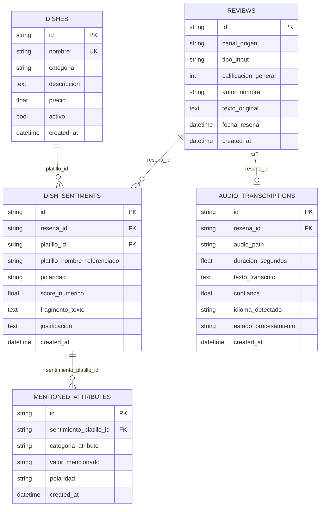
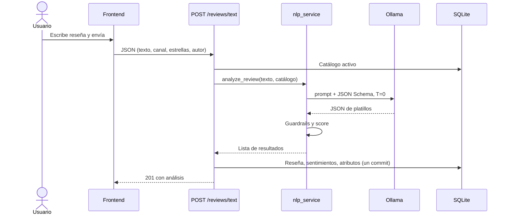
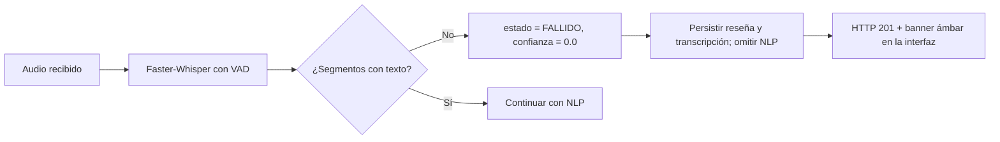
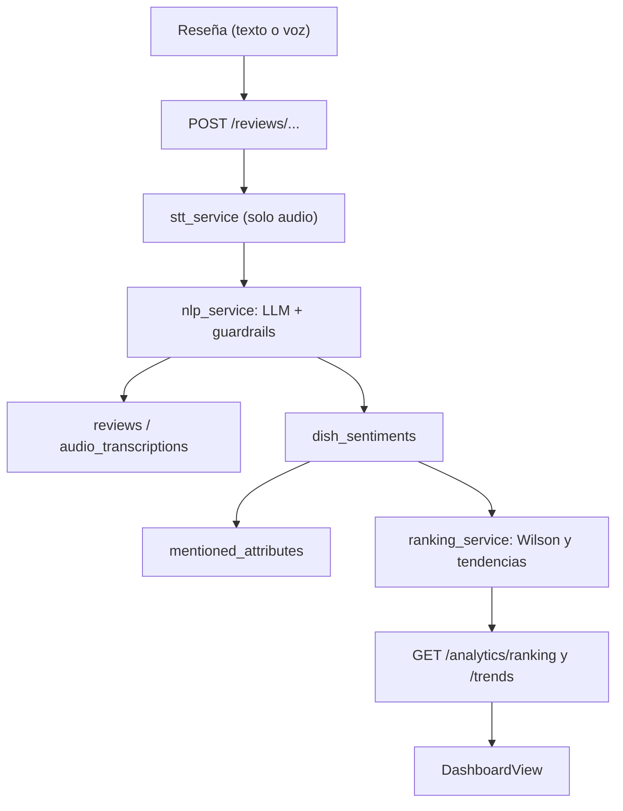

# Documentación del Proyecto: CRM Gastronómico con IA Local y Wilson Score Interval

**Materia:** Tratamiento de la Información
**Versión del sistema documentada:** 0.1.0 (MVP)
**Documento complementario:** [01_Investigacion.md](./01_Investigacion.md) (fundamentos teóricos y referencias)

> **Alcance de este documento.** Describe el sistema tal como está implementado en el código fuente. Cuando el código difiere de la documentación previa del proyecto (`README.md`, guías de presentación), se indica en la [sección 15](#15-limitaciones-riesgos-y-deuda-técnica). Los resultados de pruebas provienen de los archivos que existen en el repositorio. Los scripts de prueba **no se ejecutaron** al redactar este documento, porque requieren Ollama activo y modifican la base de datos.

---

## Índice

1. [Resumen ejecutivo](#1-resumen-ejecutivo)
2. [Planteamiento del problema y objetivos](#2-planteamiento-del-problema-y-objetivos)
3. [Requisitos](#3-requisitos)
4. [Arquitectura del sistema](#4-arquitectura-del-sistema)
5. [Diseño de la base de datos](#5-diseño-de-la-base-de-datos)
6. [Diseño del backend](#6-diseño-del-backend)
7. [Algoritmos clave](#7-algoritmos-clave)
8. [Especificación de la API](#8-especificación-de-la-api)
9. [Diseño del frontend](#9-diseño-del-frontend)
10. [Diagramas de secuencia y flujos](#10-diagramas-de-secuencia-y-flujos)
11. [Instalación y ejecución](#11-instalación-y-ejecución)
12. [Pruebas y validación](#12-pruebas-y-validación)
13. [Decisiones de ingeniería](#13-decisiones-de-ingeniería)
14. [Seguridad y privacidad](#14-seguridad-y-privacidad)
15. [Limitaciones, riesgos y deuda técnica](#15-limitaciones-riesgos-y-deuda-técnica)
16. [Trabajo futuro](#16-trabajo-futuro)
17. [Conclusiones](#17-conclusiones)
18. [Anexos](#18-anexos)

---

## 1. Resumen ejecutivo

El **CRM Gastronómico** es una aplicación web que analiza reseñas de comensales, escritas o habladas, para ayudar a los gerentes de un restaurante a saber **qué platillos gustan y cuáles generan quejas**.

| Aspecto | Descripción |
|---|---|
| **Problema** | La opinión del cliente llega como texto o voz libre. Los promedios de estrellas no indican qué platillo falló y engañan con pocas reseñas |
| **Solución** | Pipeline de IA 100 % local (transcripción, extracción estructurada, guardrails) más un ranking estadístico con Wilson Score Interval |
| **Tecnologías** | FastAPI, SQLAlchemy, SQLite, Faster-Whisper, Llama 3.2 (Ollama), React 19, TypeScript, Tailwind v4, Recharts |
| **Diferenciadores** | Privacidad total, costo por llamada nulo, ranking robusto a muestras pequeñas, resiliencia ante audio sin voz |
| **Estado** | MVP funcional validado con un dataset de 6 reseñas (5 de texto y 1 de audio) |

---

## 2. Planteamiento del problema y objetivos

### 2.1 Problema

1. El *feedback* verbal al mesero y las reseñas dispersas (Google Maps, TripAdvisor, WhatsApp) no se aprovechan de forma sistemática.
2. Una calificación global no identifica el platillo ni el atributo problemático (temperatura, sabor, porción).
3. Ordenar platillos por promedio simple favorece a los que tienen una sola reseña positiva.
4. Las soluciones SaaS cobran por uso y envían datos de clientes a terceros.

### 2.2 Objetivo general

Desarrollar un sistema que convierta reseñas en texto o voz en **información estructurada y priorizada** sobre los platillos de un restaurante, ejecutando la IA de manera local.

### 2.3 Objetivos específicos

| # | Objetivo | Cumplimiento |
|---|---|---|
| O1 | Capturar reseñas de texto y voz desde una interfaz web | Cumplido (`ReviewForm`, `AudioRecorder`) |
| O2 | Transcribir audio en español con un modelo local | Cumplido (Faster-Whisper `base`) |
| O3 | Extraer platillos, polaridad y atributos con un LLM local | Cumplido (Llama 3.2 + JSON Schema) |
| O4 | Evitar asignaciones erróneas de platillos | Cumplido parcialmente (guardrails; ver limitaciones) |
| O5 | Persistir los resultados en una base relacional normalizada | Cumplido (5 tablas) |
| O6 | Ordenar platillos con rigor estadístico | Cumplido (Wilson lower bound) |
| O7 | Visualizar KPIs, ranking, riesgos y atributos | Cumplido (Dashboard) |
| O8 | Permitir repetir experimentos con datos limpios | Cumplido (reinicio administrativo) |

### 2.4 Justificación

Con márgenes de utilidad estrechos, un restaurante necesita una solución sin costo por llamada y sin exposición de datos de sus clientes. La estadística inferencial evita decisiones basadas en muestras mínimas.

---

## 3. Requisitos

### 3.1 Requisitos funcionales

| ID | Requisito | Implementación |
|---|---|---|
| RF-01 | Registrar una reseña de texto con autor, canal y calificación opcional (1 a 5) | `POST /reviews/text` |
| RF-02 | Registrar una reseña de voz a partir de grabación o archivo | `POST /reviews/upload-audio` |
| RF-03 | Transcribir el audio y reportar duración, idioma y confianza | `stt_service.transcribe` |
| RF-04 | Sesgar la transcripción con el vocabulario del catálogo | `initial_prompt` dinámico |
| RF-05 | Identificar los platillos mencionados y su polaridad | `nlp_service.analyze_review` |
| RF-06 | Extraer y categorizar atributos (temperatura, sabor, porción, textura, precio, presentación, general) | `_infer_attribute_category` |
| RF-07 | Reasignar a "Sin Clasificar" menciones fuera del catálogo o con negación/exclusión | `_apply_guardrails` |
| RF-08 | Registrar audios sin voz como `FALLIDO` sin generar error HTTP 500 | `reviews.py` + `stt_service` |
| RF-09 | Consultar una reseña con su análisis completo | `GET /reviews/{id}` |
| RF-10 | Calcular el ranking con Wilson Score y la lista de platillos en riesgo | `GET /analytics/ranking` |
| RF-11 | Calcular tendencias reciente vs. previa y atributos más mencionados | `GET /analytics/trends` |
| RF-12 | Listar el catálogo, con filtro de activos | `GET /dishes` |
| RF-13 | Reiniciar reseñas y análisis conservando el catálogo | `POST /admin/reset-database` |
| RF-14 | Mostrar KPIs, gráficas, alertas y tarjetas de resultado | Frontend |
| RF-15 | Filtrar el catálogo por categoría | `MenuView` |

### 3.2 Requisitos no funcionales

| ID | Categoría | Requisito | Evidencia o estado |
|---|---|---|---|
| RNF-01 | Privacidad | Ningún dato sale del equipo | Ollama y Whisper locales; sin llamadas a APIs externas |
| RNF-02 | Costo | Sin costo por llamada | Modelos de código abierto |
| RNF-03 | Rendimiento | Inferencia en CPU sin GPU | `int8`, `beam_size=1`; latencias de ~1 a 2 s reportadas en el README (no medidas en este trabajo) |
| RNF-04 | Reproducibilidad | Misma entrada produce misma salida | `temperature=0.0` |
| RNF-05 | Integridad | Escritura atómica de la reseña y su análisis | Un único `commit()` |
| RNF-06 | Mantenibilidad | Separación en capas | `api`, `schemas`, `services`, `models` |
| RNF-07 | Usabilidad | Estados claros de éxito, falla de audio y error de red | `ReviewResultCard` |
| RNF-08 | Portabilidad | Migración a otro SGBD cambiando la URL | SQLAlchemy |
| RNF-09 | Seguridad | Control de acceso | **No implementado** (ver sección 14) |
| RNF-10 | Escalabilidad | Soportar carga concurrente | **No probado** |

---

## 4. Arquitectura del sistema

### 4.1 Vista de componentes



### 4.2 Arquitectura en capas del backend

| Capa | Archivos | Responsabilidad |
|---|---|---|
| Entrada | [main.py](../backend/app/main.py), `api/v1/api.py` | Crea la app, CORS, ciclo de vida y enrutador |
| Endpoints | `api/v1/endpoints/*.py` | Validan peticiones y orquestan servicios |
| Esquemas | `schemas/*.py` | Contratos Pydantic de entrada y salida |
| Servicios | `services/*.py` | Lógica de dominio: STT, NLP, ranking |
| Modelos | `models/*.py` | Entidades ORM |
| Núcleo | `core/config.py`, `core/database.py` | Configuración y sesión de base de datos |
| Datos iniciales | `db/seed.py`, `db/reset_db.py` | Catálogo semilla y reinicio |

### 4.3 Ciclo de vida de la aplicación

Al iniciar, `lifespan` en [main.py](../backend/app/main.py) ejecuta:

1. `Base.metadata.create_all(bind=engine)`: crea las tablas si no existen.
2. `seed_dishes(db)`: inserta los 7 platillos del catálogo que falten (idempotente).

### 4.4 Estructura de carpetas

```text
CRM/
├── backend/
│   ├── app/
│   │   ├── api/v1/{api.py, endpoints/{admin,analytics,dishes,reviews}.py}
│   │   ├── core/{config.py, database.py}
│   │   ├── db/{seed.py, reset_db.py}
│   │   ├── models/{dish,review,audio_transcription,sentiment,attribute}.py
│   │   ├── schemas/{dish,review,audio_transcription,sentiment,attribute,analytics}.py
│   │   ├── services/{nlp_service,stt_service,ranking_service}.py
│   │   └── main.py
│   ├── storage/audios/          # audios recibidos
│   ├── requirements.txt, .env.example
│   └── scripts de prueba y validación (*.py)
├── frontend/
│   ├── src/{components, views, services, types, App.tsx, main.tsx}
│   ├── vite.config.ts, package.json
│   └── ...
├── validation/test_llm_extraction.py
├── README.md, demo_script.md, preguntas_profesor.md, presentacion_codigo.md
└── docs/ (este documento y la investigación)
```

---

## 5. Diseño de la base de datos

### 5.1 Diagrama entidad-relación



### 5.2 Diccionario de datos

Todas las claves primarias son **UUID v4** como texto de 36 caracteres. Todas las fechas se guardan en UTC.

#### `dishes` (modelo `Platillo`): catálogo oficial

| Columna | Tipo | Restricciones | Descripción |
|---|---|---|---|
| `id` | String(36) | PK | Identificador |
| `nombre` | String(150) | UNIQUE, NOT NULL, índice | Nombre exacto del platillo |
| `categoria` | String(50) | NOT NULL, default "Plato Fuerte" | Categoría de menú |
| `descripcion` | Text | NULL | Descripción |
| `precio` | Float | NOT NULL, default 0.0 | Precio en MXN |
| `activo` | Boolean | NOT NULL, default True | Si participa en el análisis |
| `created_at` | DateTime | NOT NULL | Alta del registro |

#### `reviews` (modelo `Resena`)

| Columna | Tipo | Restricciones | Descripción |
|---|---|---|---|
| `id` | String(36) | PK | Identificador |
| `canal_origen` | String(50) | NOT NULL, default "FORMULARIO_WEB" | Origen (Google Maps, WhatsApp, etc.) |
| `tipo_input` | String(20) | NOT NULL, default "TEXTO" | `TEXTO` o `AUDIO` |
| `calificacion_general` | Integer | NULL | 1 a 5 (validado en la API) |
| `autor_nombre` | String(120) | NULL, default "Anónimo" | Autor |
| `texto_original` | Text | NOT NULL | Texto original o transcrito |
| `fecha_resena` | DateTime | NOT NULL | Fecha de la reseña |
| `created_at` | DateTime | NOT NULL | Fecha de registro |

#### `audio_transcriptions` (modelo `TranscripcionAudio`)

| Columna | Tipo | Restricciones | Descripción |
|---|---|---|---|
| `id` | String(36) | PK | Identificador |
| `resena_id` | String(36) | FK a `reviews.id`, **UNIQUE**, NOT NULL, `ON DELETE CASCADE` | Relación 1:1 |
| `audio_path` | String(255) | NOT NULL | Ruta del archivo guardado |
| `duracion_segundos` | Float | NULL | Duración |
| `texto_transcrito` | Text | NOT NULL | Texto obtenido |
| `confianza` | Float | NULL | Confianza promedio de 0 a 1 |
| `idioma_detectado` | String(10) | NOT NULL, default "es" | Idioma |
| `estado_procesamiento` | String(30) | NOT NULL, default "TRANSCRITO" | `TRANSCRITO` o `FALLIDO` |
| `created_at` | DateTime | NOT NULL | Fecha de registro |

#### `dish_sentiments` (modelo `SentimientoPlatillo`)

| Columna | Tipo | Restricciones | Descripción |
|---|---|---|---|
| `id` | String(36) | PK | Identificador |
| `resena_id` | String(36) | FK a `reviews.id`, NOT NULL, `ON DELETE CASCADE` | Reseña de origen |
| `platillo_id` | String(36) | FK a `dishes.id`, NULL, `ON DELETE SET NULL` | Platillo vinculado (NULL si es "Sin Clasificar") |
| `platillo_nombre_referenciado` | String(150) | NOT NULL | Nombre final asignado |
| `polaridad` | String(20) | NOT NULL | `positivo`, `neutral` o `negativo` |
| `score_numerico` | Float | NOT NULL, default 0.0 | −1.0, 0.0 o +1.0 |
| `fragmento_texto` | Text | NULL | Fragmento literal de la mención |
| `justificacion` | Text | NULL | Motivo del guardrail, con prefijo `[Guardrail]` |
| `created_at` | DateTime | NOT NULL | Fecha de registro (base de las tendencias) |

#### `mentioned_attributes` (modelo `AtributoMencionado`)

| Columna | Tipo | Restricciones | Descripción |
|---|---|---|---|
| `id` | String(36) | PK | Identificador |
| `sentimiento_platillo_id` | String(36) | FK a `dish_sentiments.id`, NOT NULL, `ON DELETE CASCADE` | Sentimiento asociado |
| `categoria_atributo` | String(50) | NOT NULL, default "general" | `temperatura`, `sabor`, `porcion`, `textura`, `precio_calidad`, `presentacion`, `general` |
| `valor_mencionado` | String(100) | NOT NULL | Texto del atributo (por ejemplo, "fría") |
| `polaridad` | String(20) | NOT NULL, default "neutral" | Hereda la del sentimiento |
| `created_at` | DateTime | NOT NULL | Fecha de registro |

### 5.3 Reglas de integridad y observaciones

- Una reseña tiene **como máximo una** transcripción (restricción UNIQUE en `resena_id`).
- La relación `Resena → Sentimientos → Atributos` usa `cascade="all, delete-orphan"` en el ORM.
- Una mención "Sin Clasificar" se guarda con `platillo_id = NULL` y `platillo_nombre_referenciado = "Sin Clasificar"`. Se excluye del ranking y se reporta aparte en las tendencias.
- **Observación:** el código no ejecuta `PRAGMA foreign_keys=ON`. SQLite no aplica por defecto las acciones `ON DELETE` a nivel de motor, así que la integridad en el borrado depende del ORM y del orden de borrado manual en `reset_db.py`.
- La base efectiva depende del directorio desde el que se lanza el servidor, porque `DATABASE_URL` es `sqlite:///./crm.db` (relativa). Al ejecutar desde la raíz `CRM/`, se usa `CRM/crm.db`. El archivo `CRM/backend/crm.db` mide 0 bytes y no se utiliza en ese caso.

### 5.4 Catálogo semilla

| Platillo | Categoría | Precio (MXN) |
|---|---|---|
| Tacos de Res Braseada | Tacos / Fuertes | 195.0 |
| Ribeye a la Parrilla | Cortes | 480.0 |
| Sopa Azteca | Entradas / Sopas | 110.0 |
| Guacamole Rústico | Entradas | 135.0 |
| Salmón al Ajillo | Pescados / Fuertes | 340.0 |
| Pastel Tres Leches | Postres | 95.0 |
| Agua de Horchata Artesanal | Bebidas | 45.0 |

---

## 6. Diseño del backend

### 6.1 Configuración ([config.py](../backend/app/core/config.py))

Usa `pydantic-settings`; los valores se pueden sobrescribir con un archivo `.env` (ver `.env.example`).

| Variable | Valor por defecto | Descripción |
|---|---|---|
| `PROJECT_NAME` | CRM de Análisis de Reseñas Gastronómicas | Título de la API |
| `VERSION` | 0.1.0 | Versión |
| `API_V1_STR` | `/api/v1` | Prefijo de rutas |
| `DATABASE_URL` | `sqlite:///./crm.db` | Conexión a la base de datos |
| `OLLAMA_BASE_URL` | `http://localhost:11434` | Servicio de Ollama |
| `OLLAMA_MODEL` | `llama3.2:latest` | Modelo de lenguaje |
| `WHISPER_MODEL_SIZE` | `base` | Tamaño de Whisper |
| `WHISPER_DEVICE` | `cpu` | Dispositivo |
| `WHISPER_COMPUTE_TYPE` | `int8` | Cuantización |
| `GUARDRAIL_NEGATION_KEYWORDS` | Lista de 18 frases | Palabras clave de exclusión o duda |
| `STORAGE_DIR` | `backend/storage/audios` | Carpeta de audios (se crea al iniciar) |

**Palabras clave del guardrail:** `no venia`, `no venian`, `no era`, `no eran`, `fuera del`, `fuera de`, `otro`, `otra`, `otros`, `otras`, `no estaba`, `no estaban`, `diferente`, `diferentes`, `no pedi`, `no pedimos`, `en vez de`, `en lugar de`.

> **Nota.** `OLLAMA_BASE_URL` está definida pero `nlp_service` llama a `ollama.chat(...)` sin pasar un cliente con ese `host`. Por tanto, se usa el valor por defecto de la biblioteca o la variable de entorno `OLLAMA_HOST`, y no esta configuración.

### 6.2 Orquestación de la ingesta ([reviews.py](../backend/app/api/v1/endpoints/reviews.py))

La función `_procesar_y_persistir_resena` es el punto central de ambos flujos (texto y audio):

1. Consulta el catálogo activo (`nombre` y mapa nombre-platillo).
2. Si el audio **no** falló, llama a `nlp_service.analyze_review(texto, catalogo)`.
3. Crea la `Resena` y hace `flush()` para obtener su `id`.
4. Si hay datos de transcripción, crea `TranscripcionAudio`.
5. Por cada ítem del NLP, crea un `SentimientoPlatillo` (con justificación `[Guardrail] ...` si fue reasignado) y sus `AtributoMencionado`.
6. Hace un único `commit()` y recarga la reseña con `joinedload` de transcripción, sentimientos y atributos.

### 6.3 Servicio STT ([stt_service.py](../backend/app/services/stt_service.py))

- **Patrón Singleton** (`STTService.get_instance()`) con **carga perezosa** del modelo: se carga en la primera transcripción, no al iniciar el servidor.
- Construye el `initial_prompt` como `"Vocabulario esperado del restaurante y menú: <platillos separados por coma>."`.
- Transcribe con `language="es"`, `beam_size=1`, `vad_filter=True`.
- Devuelve un diccionario con `texto_transcrito`, `duracion_segundos`, `idioma_detectado`, `confianza`, `estado_procesamiento` y `tiempo_inferencia_segundos`.
- **Manejo de fallos:** si no hay segmentos o el texto queda vacío, devuelve `estado_procesamiento = "FALLIDO"` con confianza 0.0. Si ocurre una excepción, también devuelve `FALLIDO` con el mensaje de error.

### 6.4 Servicio NLP ([nlp_service.py](../backend/app/services/nlp_service.py))

Se describe en detalle en la [sección 7.2](#72-extracción-estructurada-con-llm). Ante cualquier excepción de la llamada a Ollama o de la validación JSON, imprime el error en consola y **devuelve una lista vacía**. La reseña se persiste entonces sin sentimientos (ver limitaciones).

### 6.5 Servicio de ranking ([ranking_service.py](../backend/app/services/ranking_service.py))

Implementa `wilson_score_lower_bound`, `calculate_ranking` y `calculate_trends` (sección 7.4 y 7.5).

### 6.6 Reinicio de la base de datos ([reset_db.py](../backend/app/db/reset_db.py))

Borra, **en este orden**, atributos, sentimientos, transcripciones y reseñas, y luego vuelve a ejecutar `seed_dishes`. El catálogo no se elimina. Los archivos de audio en `storage/audios` **no** se borran.

---

## 7. Algoritmos clave

### 7.1 Pipeline de transcripción

```text
ENTRADA: archivo de audio, catálogo de platillos
1. prompt ← "Vocabulario esperado del restaurante y menú: " + unir(catálogo) + "."
2. (segmentos, info) ← Whisper.transcribe(audio, es, beam=1, vad=True, prompt)
3. Para cada segmento: p_i ← min(max(exp(avg_logprob_i), 0), 1)
4. SI no hay segmentos O texto vacío:
       RETORNAR {texto:"", confianza:0.0, estado:"FALLIDO"}
5. confianza ← promedio(p_i)
6. RETORNAR {texto, duración, idioma, confianza, estado:"TRANSCRITO"}
```

### 7.2 Extracción estructurada con LLM

**Prompt.** El servicio construye un mensaje de usuario con:

1. Rol: extractor de reseñas gastronómicas.
2. **Catálogo oficial** en lista cerrada (un platillo por línea, entre comillas).
3. Reglas estrictas:
   - `platillo_sugerido` debe ser **exactamente** un nombre del catálogo, o `"Sin Clasificar"` si hay mención de comida sin coincidencia clara.
   - No inventar nombres.
   - Si no hay platillos mencionados, devolver `[]`.
   - `texto_mencionado` es el fragmento breve de la mención, no la reseña completa.
   - `polaridad` ∈ {positivo, neutral, negativo}.
   - `atributos` es una lista de cadenas (por ejemplo `["fría"]`, `["dura", "porción chica"]`).

**Llamada.** `ollama.chat(model, messages, format=<JSON Schema de AnalisisResenaLLM>, options={"temperature": 0.0})`. La respuesta se valida con Pydantic (`model_validate_json`).

**Postproceso por cada platillo extraído:**

1. Aplicar guardrails (7.3).
2. Calcular `score_numerico`: +1.0, 0.0 o −1.0 según la polaridad.
3. Categorizar cada atributo con `_infer_attribute_category`.

**Categorización de atributos.** Heurística por palabras clave sobre el texto normalizado (sin acentos y en minúsculas), evaluada en este orden de prioridad:

| Prioridad | Categoría | Ejemplos de palabras clave |
|---|---|---|
| 1 | `temperatura` | frio, caliente, tibio, helado, temperatura |
| 2 | `sabor` | salado, dulce, acido, amargo, rico, delicioso, exquisito, desabrido, sabor, bueno, malo |
| 3 | `porcion` | porcion, chica, pequeno, grande, mucho, poco, abundante |
| 4 | `textura` | dura, duro, suave, tierno, crujiente, correoso, textura, aguado, grasoso |
| 5 | `precio_calidad` | caro, barato, precio, costo |
| 6 | `presentacion` | presentacion, aspecto, montaje, bonito, feo |
| 7 | `general` | cualquier otro |

> La coincidencia es por **subcadena** y en orden de prioridad. Por ejemplo, "grasosa" no contiene la subcadena `grasoso` y "salada" no contiene `salado`, por lo que ambas quedan como `general`, igual que "fresca" y "decepción total". Esto se observa en el benchmark (sección 12.3).

### 7.3 Guardrails

```text
ENTRADA: ítem del LLM, texto completo, catálogo
1. SI platillo_sugerido ∉ catálogo Y ≠ "Sin Clasificar":
       RETORNAR ("Sin Clasificar", reasignado=True, motivo="no pertenece al catálogo")
2. cláusulas ← dividir(texto_normalizado, [, . ; \n] | "pero" | "aunque" | "sin embargo" | "ademas")
3. palabras_mención ← palabras de longitud > 3 de texto_mencionado (normalizado)
4. PARA CADA palabra clave kw de GUARDRAIL_NEGATION_KEYWORDS:
       a) SI kw aparece (con límites de palabra) en texto_mencionado:
              RETORNAR ("Sin Clasificar", True, motivo)
       b) PARA CADA cláusula:
              SI kw aparece en la cláusula Y
                 la cláusula contiene alguna palabra de la mención
                 O alguna palabra (>3 letras) del nombre sugerido:
                     RETORNAR ("Sin Clasificar", True, motivo)
5. RETORNAR (platillo_sugerido, False, None)
```

**Efecto.** El guardrail cambia únicamente el **platillo asignado** (a "Sin Clasificar"). **No modifica la polaridad** ni los atributos del ítem. La justificación se guarda en `dish_sentiments.justificacion`.

### 7.4 Ranking con Wilson Score

**Fórmula** (límite inferior, $z=1.96$):

$$
W_{lb}=\frac{\hat p+\frac{z^2}{2n}-z\sqrt{\frac{\hat p(1-\hat p)+\frac{z^2}{4n}}{n}}}{1+\frac{z^2}{n}},\qquad \hat p=\frac{\text{positivas}}{n}
$$

**Procedimiento de `calculate_ranking`:**

1. Obtener platillos activos.
2. Tomar los `SentimientoPlatillo` con `platillo_id` no nulo y nombre distinto de "Sin Clasificar".
3. Agrupar por platillo y contar positivas, negativas, neutrales y total.
4. Calcular `tasa_positiva`, `tasa_negativa` (3 decimales) y `score_ponderado` (4 decimales) con Wilson.
5. **Top Platillos:** orden descendente por `(score_ponderado, total_menciones)`.
6. **Platillos en Riesgo:** los que tienen al menos 1 negativa, ordenados por `(tasa_negativa, negativas, −score_ponderado)` descendente.

**Observaciones.**
- Una mención **neutral cuenta como no positiva** en Wilson.
- Solo aparecen platillos con al menos una mención.
- Con una sola reseña negativa un platillo ya entra a "En Riesgo" (umbral mínimo de 1).

**Ejemplos con la implementación del proyecto:**

| Positivas | Total | $W_{lb}$ |
|---|---|---|
| 1 | 1 | 0.2065 |
| 2 | 2 | 0.3424 |
| 0 | 1 | 0.0000 |
| 80 | 82 | 0.9154 |

### 7.5 Tendencias

`calculate_trends(db, dias=7)`:

1. Define la ventana **reciente** `[ahora − dias, ahora]` y la **previa** `[ahora − 2·dias, ahora − dias)`.
2. Por platillo, calcula el promedio de `score_numerico` en cada ventana.
3. $\Delta = \bar s_{reciente} - \bar s_{previo}$; **MEJORANDO** si $\Delta \ge 0.15$, **EMPEORANDO** si $\Delta \le -0.15$, **ESTABLE** en otro caso, y **SIN_DATOS_PREVIOS** si no hay menciones en la ventana previa.
4. Agrega atributos por categoría (total, positivas, negativas, neutrales y hasta 4 ejemplos) por platillo, y globalmente (hasta 5 ejemplos).
5. Reporta aparte las menciones "Sin Clasificar" con sus atributos.

Se usa la fecha de creación de la fila de sentimiento (`created_at`).

---

## 8. Especificación de la API

**URL base:** `http://127.0.0.1:8000/api/v1` · **Documentación interactiva:** `/docs` (Swagger) y `/redoc` · **OpenAPI:** `/api/v1/openapi.json`

### 8.1 Resumen de endpoints

| Método | Ruta | Descripción | Código de éxito |
|---|---|---|---|
| GET | `/` (raíz del servidor) | Estado del servicio | 200 |
| GET | `/dishes` | Listar el catálogo | 200 |
| POST | `/reviews/text` | Ingestar reseña de texto | 201 |
| POST | `/reviews/upload-audio` | Ingestar reseña de audio | 201 |
| GET | `/reviews/{review_id}` | Detalle de una reseña | 200 |
| GET | `/analytics/ranking` | Ranking Wilson y platillos en riesgo | 200 |
| GET | `/analytics/trends` | Tendencias y atributos | 200 |
| POST | `/admin/reset-database` | Reiniciar reseñas y análisis | 200 |

### 8.2 `GET /dishes`

| Parámetro | Tipo | Defecto | Descripción |
|---|---|---|---|
| `solo_activos` | bool (query) | `true` | Filtra por `activo` |

Respuesta: lista de `DishResponse` (`id`, `nombre`, `categoria`, `descripcion`, `precio`, `activo`, `created_at`), ordenada por categoría y nombre.

### 8.3 `POST /reviews/text`

**Cuerpo (JSON):**

| Campo | Tipo | Obligatorio | Validación |
|---|---|---|---|
| `texto` | string | Sí | longitud mínima 3 |
| `canal_origen` | string | No | defecto `FORMULARIO_WEB` |
| `calificacion_general` | int | No | 1 a 5 |
| `autor_nombre` | string | No | defecto `Anónimo` |

**Ejemplo de petición (reseña real del dataset de validación):**

```json
{
  "texto": "el ribeye a la parrilla estaba duro y frío, una decepción total",
  "canal_origen": "TRIPADVISOR",
  "calificacion_general": 2,
  "autor_nombre": "Lucía Morales"
}
```

**Estructura de respuesta (`ReviewDetailResponse`, 201):**

```json
{
  "id": "<uuid>",
  "canal_origen": "TRIPADVISOR",
  "tipo_input": "TEXTO",
  "calificacion_general": 2,
  "autor_nombre": "Lucía Morales",
  "texto_original": "el ribeye a la parrilla estaba duro y frío, una decepción total",
  "fecha_resena": "<datetime UTC>",
  "created_at": "<datetime UTC>",
  "transcripcion": null,
  "sentimientos": [
    {
      "id": "<uuid>",
      "platillo_id": "<uuid>",
      "platillo_nombre_referenciado": "Ribeye a la Parrilla",
      "polaridad": "negativo",
      "score_numerico": -1.0,
      "fragmento_texto": "<fragmento>",
      "justificacion": null,
      "created_at": "<datetime UTC>",
      "atributos": [
        { "categoria_atributo": "textura",     "valor_mencionado": "dura",            "polaridad": "negativo" },
        { "categoria_atributo": "general",     "valor_mencionado": "decepción total", "polaridad": "negativo" },
        { "categoria_atributo": "temperatura", "valor_mencionado": "fría",            "polaridad": "negativo" }
      ]
    }
  ]
}
```

*(La plataforma y los atributos corresponden a lo registrado en el benchmark; los identificadores y fechas se omiten.)*

### 8.4 `POST /reviews/upload-audio`

Formato `multipart/form-data`.

| Campo | Tipo | Obligatorio | Descripción |
|---|---|---|---|
| `file` | archivo | Sí | `.wav`, `.mp3`, `.m4a`, `.webm`, etc. |
| `canal_origen` | string | No | defecto `AUDIO_IN_SITU` |
| `calificacion_general` | int | No | 1 a 5 |
| `autor_nombre` | string | No | defecto `Anónimo` |

El archivo se guarda con un nombre `uuid4` en `storage/audios/`. La respuesta incluye el objeto `transcripcion`:

```json
"transcripcion": {
  "audio_path": ".../storage/audios/<uuid>.webm",
  "duracion_segundos": 4.91,
  "texto_transcrito": "...",
  "confianza": 0.88,
  "idioma_detectado": "es",
  "estado_procesamiento": "TRANSCRITO"
}
```

*(Los valores numéricos de este ejemplo son ilustrativos; no provienen de una ejecución registrada.)*

**Caso audio sin voz (verificado en `test_case_c.py`):** respuesta **201** con `estado_procesamiento = "FALLIDO"`, `confianza = 0.0`, `sentimientos = []`, y `texto_original = "(Audio sin contenido de voz inteligible detectado)"`.

### 8.5 `GET /reviews/{review_id}`

Devuelve el mismo esquema que la ingesta. Si el identificador no existe, responde **404** con `{"detail": "Reseña con ID '<id>' no encontrada."}`.

### 8.6 `GET /analytics/ranking`

Sin parámetros. Respuesta (`RankingResponse`):

```json
{
  "total_evaluaciones": 10,
  "top_platillos": [
    { "platillo_id": "...", "nombre": "Salmón al Ajillo", "categoria": "Pescados / Fuertes",
      "total_menciones": 2, "positivas": 2, "negativas": 0, "neutrales": 0,
      "score_ponderado": 0.3424, "tasa_positiva": 1.0, "tasa_negativa": 0.0 }
  ],
  "platillos_en_riesgo": [
    { "nombre": "Ribeye a la Parrilla", "total_menciones": 2, "positivas": 0, "negativas": 2,
      "score_ponderado": 0.0, "tasa_positiva": 0.0, "tasa_negativa": 1.0 }
  ]
}
```

### 8.7 `GET /analytics/trends`

| Parámetro | Tipo | Defecto | Rango |
|---|---|---|---|
| `dias` | int (query) | 7 | 1 a 90 |

Respuesta (`TrendsResponse`): `periodo_dias`, `fecha_corte`, `tendencias_por_platillo[]` (con `menciones_periodo_reciente`, `score_polaridad_reciente`, `menciones_periodo_previo`, `score_polaridad_previo`, `cambio_polaridad`, `tendencia`, `atributos_destacados[]`), `atributos_mas_mencionados_global[]` y `menciones_sin_clasificar`.

### 8.8 `POST /admin/reset-database`

Sin cuerpo. Respuesta 200: `{"status": "success", "message": "Base de datos reseteada exitosamente. Catálogo restaurado limpio."}`.

### 8.9 Códigos de estado usados

| Código | Cuándo |
|---|---|
| 200 | Consultas y reinicio exitosos |
| 201 | Reseña creada (incluye audios `FALLIDO`) |
| 404 | Reseña inexistente |
| 422 | Validación de Pydantic (texto muy corto, calificación fuera de 1 a 5) |

---

## 9. Diseño del frontend

### 9.1 Estructura

| Carpeta o archivo | Contenido |
|---|---|
| `App.tsx` | Navegación por pestañas (`RANKING`, `INGESTA`, `CATALOGO`), con lectura opcional de `?tab=` en la URL, e indicador de estado del backend (consulta `GET /api/v1/dishes`) |
| `views/DashboardView.tsx` | KPIs, ranking, riesgos y gráficas |
| `views/IngestaView.tsx` | Formulario de ingesta, resultado inmediato y reseñas recientes de la sesión |
| `views/MenuView.tsx` | Catálogo con filtro por categoría y reinicio con modal de confirmación |
| `components/` | `ReviewForm`, `AudioRecorder`, `ReviewResultCard`, `RankingTable`, `RankingChart`, `AttributesChart`, `RiskAlerts`, `DishCard` |
| `services/api.ts` | Cliente `fetch` con manejo de errores (lee `detail` de FastAPI) |
| `types/index.ts` | Interfaces TypeScript espejo de los esquemas del backend |

### 9.2 Vistas

| Vista | Funcionalidad |
|---|---|
| **Dashboard & Ranking** | 4 tarjetas KPI (evaluaciones, platillo líder, platillos en riesgo, confiabilidad Wilson), tabla de ranking, gráfica comparativa del Wilson Score, gráfica apilada de atributos y alertas de riesgo. Consulta `getRanking()` y `getTrends(7)` |
| **Ingesta de Reseñas** | Pestañas Texto y Audio. Selector de canal, autor y estrellas. Presets de texto de ejemplo. Grabación con micrófono o carga de archivo |
| **Catálogo & Admin** | Grilla de platillos, filtros por categoría y botón de reinicio con confirmación |

### 9.3 Estados de la tarjeta de resultado

`ReviewResultCard` distingue tres casos: **éxito** (platillos, polaridad, atributos y justificación del guardrail), **audio `FALLIDO`** (banner ámbar de advertencia) y **error de red o servidor** (tarjeta roja).

### 9.4 Comunicación con el backend

El proxy de Vite (`/api` hacia `http://127.0.0.1:8000`) evita problemas de CORS en desarrollo. El estado del backend se muestra en la barra superior (en línea, fuera de línea o comprobando).

---

## 10. Diagramas de secuencia y flujos

### 10.1 Ingesta de texto



### 10.2 Ingesta de audio

Ver el diagrama de secuencia de la sección 4.2 de [01_Investigacion.md](./01_Investigacion.md#42-secuencia-de-una-reseña-de-voz).

### 10.3 Audio sin voz



---

## 11. Instalación y ejecución

### 11.1 Prerrequisitos

| Requisito | Versión |
|---|---|
| Python | 3.11 o 3.12 (el entorno del proyecto usa 3.12) |
| Node.js y npm | Node 18 o superior |
| Ollama | Instalado y en ejecución |
| Modelo de lenguaje | `ollama pull llama3.2:latest` |

La primera transcripción descarga el modelo `base` de Whisper desde internet (después funciona sin conexión).

### 11.2 Backend

```bash
# desde la raíz CRM/
pip install -r backend/requirements.txt
python -m uvicorn app.main:app --host 127.0.0.1 --port 8000 --app-dir backend --reload
```

Swagger: `http://127.0.0.1:8000/docs`.

**Dependencias** (`requirements.txt`): `fastapi`, `uvicorn[standard]`, `sqlalchemy`, `pydantic`, `pydantic-settings`, `ollama`, `faster-whisper`, `av` (>=11, <14), `python-multipart`, `httpx`.

### 11.3 Frontend

```bash
cd frontend
npm install
npm run dev      # http://localhost:5173
```

Otros comandos: `npm run build` (`tsc -b && vite build`), `npm run lint` (`oxlint`), `npm run preview`.

### 11.4 Variables de entorno (`backend/.env`)

```env
DATABASE_URL=sqlite:///./crm.db
OLLAMA_BASE_URL=http://localhost:11434
OLLAMA_MODEL=llama3.2:latest
WHISPER_MODEL_SIZE=base
WHISPER_DEVICE=cpu
WHISPER_COMPUTE_TYPE=int8
```

---

## 12. Pruebas y validación

### 12.1 Metodología

La validación del sistema combina dos enfoques:
1. **Suite de pruebas automatizadas con `pytest` (25 pruebas unitarias e integración)**: Ubicadas en `backend/tests/`, simulan el LLM y el STT mediante *mocks* para ejecutarse de forma determinista y ultrarrápida (<2 segundos) sin requerir servicios externos activos.
2. **Scripts ejecutables de validación end-to-end**: Para pruebas de sistema completo contra Ollama y Faster-Whisper.
3. **Corpus etiquetado de 50 reseñas (`validation/corpus_resenas.csv`)**: Evaluado mediante `validation/evaluar_corpus.py` para medir exactitud y latencia.

| Archivo de prueba | Tipo | Qué verifica |
|---|---|---|
| `backend/tests/test_wilson.py` | Pytest Unitario | 11 casos de prueba: valores conocidos (0.2065, 0.3424, 0.9154), orden de volumen, penalización con pocas muestras, límites [0, 1] |
| `backend/tests/test_guardrails.py` | Pytest Unitario | Normalización Unicode, pertenencia estricta a catálogo, detección de negación/exclusión y 7 categorías de atributos |
| `backend/tests/test_api.py` | Pytest Integración | 9 pruebas con `TestClient`: salud, catálogo, ingesta con éxito, resiliencia ante fallo de NLP (`FALLIDO_NLP`), validación Pydantic, 404, audio silencioso, analíticas y reset |
| `validation/evaluar_corpus.py` | Script Evaluación | Evaluación sistemática de 50 reseñas anotadas (directas, negación, multiplatillo, fuera de catálogo) |
| `validation/test_llm_extraction.py` | Script Standalone | Fase previa: extracción estructurada con Llama 3.2 (3B), catálogo cerrado y sinónimos |
| `backend/test_api_endpoints.py` | Script E2E | Prueba end-to-end con servicios reales sobre catálogo, texto y audio |
| `backend/test_case_c.py` | Script Aserción | Audio de silencio: 201, `FALLIDO`, confianza 0.0 y cero sentimientos |
| `backend/run_clean_benchmark.py` | Script Benchmark | Reinicio, ingesta de 6 reseñas y consulta de ranking y tendencias |

### 12.2 Dataset de validación

| # | Tipo | Canal | Texto |
|---|---|---|---|
| 1 | Texto | Google Maps | "los tacos de res braseada estuvieron increíbles y el agua de horchata artesanal muy fresca" |
| 2 | Texto | TripAdvisor | "el ribeye a la parrilla estaba duro y frío, una decepción total" |
| 3 | Texto | Formulario web | "pedimos ribeye a la parrilla y la carne estaba muy grasosa, no lo recomiendo" |
| 4 | Texto | WhatsApp | "el salmón al ajillo delicioso y el pastel tres leches es una maravilla de porción grande" |
| 5 | Texto | Google Maps | "la sopa azteca estaba fría y excesivamente salada, pero el guacamole rústico sí nos gustó" |
| 6 | **Audio** | Audio in situ | Transcripción obtenida: "El Salmón al Ajillo estaba en su punto y el Pastel Tres Leches delicioso." |

### 12.3 Resultados del benchmark (`clean_benchmark_output.txt`)

**Extracción por reseña (resultado registrado):**

| # | Platillo asignado | Polaridad | Atributos extraídos |
|---|---|---|---|
| 1 | Tacos de Res Braseada | positivo | (ninguno) |
| 1 | Agua de Horchata Artesanal | positivo | fresca |
| 2 | Ribeye a la Parrilla | negativo | dura, decepción total, fría |
| 3 | Ribeye a la Parrilla | negativo | grasosa |
| 4 | Salmón al Ajillo | positivo | (ninguno) |
| 4 | Pastel Tres Leches | positivo | porción grande |
| 5 | Sopa Azteca | negativo | excesivamente salada, fría |
| 5 | Guacamole Rústico | positivo | (ninguno) |
| 6 | Salmón al Ajillo | positivo | (ninguno) |
| 6 | Pastel Tres Leches | positivo | (ninguno) |

Total: **10 evaluaciones**, todas asignadas a platillos del catálogo (0 menciones "Sin Clasificar").

**Ranking resultante:**

| Posición | Platillo | Menciones | Positivas | Negativas | Wilson | Tasa positiva |
|---|---|---|---|---|---|---|
| 1 | Salmón al Ajillo | 2 | 2 | 0 | **0.3424** | 100 % |
| 1 | Pastel Tres Leches | 2 | 2 | 0 | **0.3424** | 100 % |
| 3 | Tacos de Res Braseada | 1 | 1 | 0 | **0.2065** | 100 % |
| 3 | Agua de Horchata Artesanal | 1 | 1 | 0 | **0.2065** | 100 % |
| 3 | Guacamole Rústico | 1 | 1 | 0 | **0.2065** | 100 % |
| 6 | Ribeye a la Parrilla | 2 | 0 | 2 | 0.0000 | 0 % |
| 6 | Sopa Azteca | 1 | 0 | 1 | 0.0000 | 0 % |

**Platillos en riesgo:** Ribeye a la Parrilla (2 de 2 negativas) y Sopa Azteca (1 de 1).

**Tendencias** (`dias=7`, corte 2026-10-21): todos los platillos aparecen como `SIN_DATOS_PREVIOS`, lo esperado porque todas las reseñas son recientes. El Ribeye tiene puntaje reciente −1.0; Salmón y Pastel, +1.0.

**Atributos globales:**

| Categoría | Menciones | Positivas | Negativas |
|---|---|---|---|
| general | 4 | 1 | 3 |
| temperatura | 2 | 0 | 2 |
| textura | 1 | 0 | 1 |
| porcion | 1 | 1 | 0 |

### 12.4 Verificación realizada al redactar este documento

- Se **recalcularon** con la función `wilson_score_lower_bound` del proyecto los valores 0.2065 (1 de 1) y 0.3424 (2 de 2): **coinciden** con el benchmark.
- Se verificó que las 10 evaluaciones del benchmark corresponden a las menciones de las 6 reseñas (2+1+1+2+2+2 = 10).
- Se revisó en el código que las rutas, los esquemas y los campos documentados existen.

### 12.5 Hallazgos de la validación

| Observación | Detalle |
|---|---|
| El LLM no siempre extrae atributos positivos | "increíbles", "delicioso" y "en su punto" no aparecen como atributos (reseñas 1, 4, 5 y 6) |
| Categorización heurística imperfecta | "grasosa", "fresca", "excesivamente salada" y "decepción total" quedan en `general` (4 de los 8 atributos registrados) |
| Empates en el ranking | Con pocas menciones varios platillos comparten el mismo Wilson |
| Cifras de Whisper con y sin `initial_prompt` | La documentación del proyecto reporta una mejora de confianza de ~73 % a ~85–90 %. El script `test_stt_experiments.py` existe, pero **no se conserva una salida registrada** y esas cifras no se pudieron verificar |
| Tamaño de la muestra | 6 reseñas validan el funcionamiento, no la **precisión estadística** del sistema. No se calcularon precisión, exhaustividad ni F1 |

---

## 13. Decisiones de ingeniería

| # | Problema | Alternativas | Decisión | Justificación |
|---|---|---|---|---|
| D1 | Privacidad y costo de la IA | APIs en la nube / IA local | **IA local** (Ollama + Faster-Whisper) | Datos de clientes no salen del equipo; sin costo por llamada |
| D2 | Modelo de lenguaje | Modelos grandes / Llama 3.2 3B | **Llama 3.2 3B** | Suficiente para el volumen y corre en CPU; validación previa en `validation/` |
| D3 | Formato de salida del LLM | Texto libre + análisis con regex / JSON Schema | **JSON Schema** con Pydantic | Salida validable por contrato |
| D4 | Reproducibilidad | Muestreo con temperatura / voluntad voraz | **`temperature = 0.0`** | Misma entrada produce misma salida |
| D5 | Errores de asignación del LLM | Confiar en el modelo / reglas posteriores | **Guardrails deterministas** | El LLM propone y Python decide |
| D6 | Vocabulario del menú en STT | Modelo más grande / sesgo de prompt | **`initial_prompt` dinámico** | Bajo costo; usa el catálogo vigente |
| D7 | Fórmula de ranking | Promedio / media bayesiana con penalización / Wilson | **Wilson lower bound** | Robusto con pocas muestras; la media bayesiana con penalización se descartó por penalizar doblemente las negativas |
| D8 | Audio sin voz | Responder error 500 / persistir como fallido | **Persistir `FALLIDO` con 201** | Preserva la trazabilidad sin afectar el ranking |
| D9 | Base de datos | PostgreSQL / SQLite | **SQLite** | Cero configuración para un MVP; migración posible con SQLAlchemy |
| D10 | Menciones fuera del catálogo | Descartar / crear platillos / categoría de escape | **"Sin Clasificar"** | No contamina el ranking y se reporta aparte |
| D11 | Benchmarks repetibles | Borrar el archivo `.db` / endpoint de reinicio | **`POST /admin/reset-database`** | Conserva el catálogo y se puede usar desde la interfaz |

---

## 14. Seguridad y privacidad

| Aspecto | Estado |
|---|---|
| **Privacidad de datos** | Fortaleza: texto y audio se procesan localmente y no se envían a terceros |
| **Autenticación y autorización** | **Ausente**. Cualquier cliente con acceso a la red puede llamar a todos los endpoints |
| **Endpoint destructivo** | `POST /admin/reset-database` no está protegido |
| **CORS** | `allow_origins=["*"]` con `allow_credentials=True`; aceptable para desarrollo, no para producción |
| **Carga de archivos** | Se conserva la extensión del nombre original (`os.path.splitext`) y no se valida el tipo ni el tamaño máximo del archivo |
| **Retención de audios** | Los audios se almacenan y **nunca se eliminan** (ni al reiniciar la base de datos) |
| **Inyección SQL** | Riesgo bajo: se usa el ORM con consultas parametrizadas |
| **Inyección de prompt** | El texto de la reseña se inserta en el prompt sin sanitización. Una reseña maliciosa podría intentar influir en el LLM; el esquema JSON y los guardrails mitigan parcialmente el efecto |

---

## 15. Limitaciones, riesgos y deuda técnica

### 15.1 Inconsistencias entre el código y la documentación o la interfaz

| # | Hallazgo | Impacto | Corrección sugerida |
|---|---|---|---|
| I-1 | ~~El README decía que el guardrail "rectifica la polaridad"~~ | La documentación sobrestimaba la capacidad del guardrail | **Corregido:** README alineado; reasigna a "Sin Clasificar" con justificación trazable |
| I-2 | ~~El frontend comparaba `polaridad === 'POSITIVO'` / `'NEGATIVO'` (mayúsculas), pero el backend devuelve `positivo` / `negativo` (minúsculas)~~. En `ReviewResultCard` las insignias de polaridad siempre caían en el estilo neutro (gris) | Defecto visual funcional: el color de polaridad no se aplicaba | **Corregido:** `ReviewResultCard.tsx` y el tipo `Sentiment.polaridad` ahora usan minúsculas |
| I-3 | ~~`api.ts` enviaba `?limit=` a `/analytics/ranking` y `?dias_reciente&dias_previo` a `/analytics/trends`~~, pero el backend no define `limit` y solo acepta `dias` en tendencias | Los parámetros se ignoraban; las tendencias siempre usaban 7 días | **Corregido:** `getRanking()` no envía parámetros y `getTrends(dias)` envía `?dias=` (ventana reciente y previa de igual tamaño) |
| I-4 | ~~La guía `presentacion_codigo.md` citaba `components/reviews/ReviewResultCard.tsx`~~ | Ruta incorrecta en la guía | **Corregido:** ruta actualizada a `components/ReviewResultCard.tsx` |
| I-5 | ~~El README omitía `GET /reviews/{id}`~~ | Documentación incompleta | **Corregido:** endpoint agregado a la tabla de endpoints del README |
| I-6 | El README describe `storage/audios` como "archivos temporales", pero el código conserva los archivos para auditoría | Crecimiento del almacenamiento local | Documentación alineada como almacenamiento local de grabaciones |
| I-7 | ~~`OLLAMA_BASE_URL` estaba definida pero no se usaba al invocar Ollama~~ | Configuración sin efecto | **Corregido:** `nlp_service.py` inicializa `ollama.Client(host=settings.OLLAMA_BASE_URL)` |
| I-8 | ~~El tipo `Sentiment.polaridad` del frontend declaraba solo mayúsculas~~ | Tipado que no reflejaba la realidad | **Corregido** junto con I-2 |
| I-9 | ~~Ruta relativa `./crm.db` generaba dos bases si se ejecutaba desde `CRM/backend`~~ | Confusión sobre base de datos activa | **Corregido:** `config.py` ancla la ruta absoluta canónica a la raíz de `CRM/crm.db` |

### 15.2 Limitaciones técnicas

| # | Limitación | Detalle |
|---|---|---|
| L-1 | **Palabras clave del guardrail** | Términos generales (`otro`, `otra`, `diferente`) pueden causar falsos positivos, y la negación indirecta puede escaparse |
| L-2 | ~~Fallo silencioso del NLP~~ | **Mitigado:** Al fallar Ollama, se captura `NLPServiceError`, la reseña se guarda con `estado_analisis = "FALLIDO_NLP"` y el frontend muestra un banner explicativo |
| L-3 | **Procesamiento síncrono** | Whisper y Ollama se ejecutan dentro de la petición HTTP |
| L-4 | **Concurrencia** | SQLite admite un solo escritor a la vez; no se hicieron pruebas de carga |
| L-5 | **Wilson binario** | Una mención neutral cuenta como no positiva; no se usa el puntaje continuo |
| L-6 | **Tendencias heurísticas** | Umbral fijo de ±0.15, sin prueba de significancia, y con muy pocos datos es ruido |
| L-7 | **Categorización de atributos** | Heurística por subcadenas; `general` es una categoría residual muy frecuente |
| L-8 | **Idioma y dialecto** | Se fuerza el español; no se probaron acentos ni dialectos distintos |
| L-9 | **Tamaño del modelo** | Un LLM de 3B puede sobreasociar menciones genéricas con un platillo cuyo nombre comparte una palabra |
| L-10 | ~~Validación limitada~~ | **Ampliación implementada:** 25 pruebas unitarias con `pytest` pasando al 100% y corpus estructurado de 50 casos (`corpus_resenas.csv`) con script de evaluación |
| L-11 | **Catálogo fijo** | Solo se modifica desde el código (`seed.py`); no hay API ni interfaz de edición |
| L-12 | **Calificación de estrellas sin uso analítico** | `calificacion_general` se guarda pero no interviene en el ranking |

### 15.3 Riesgos

| Riesgo | Probabilidad | Impacto | Mitigación actual |
|---|---|---|---|
| Ollama caído (reseñas sin análisis) | Media | Alto | Ninguna (ver L-2) |
| Reinicio accidental de la base de datos | Media | Alto | Modal de confirmación en la interfaz; sin autenticación |
| Alucinación del LLM | Media | Medio | Catálogo cerrado y guardrails |
| Pérdida de datos por un único archivo SQLite | Baja | Alto | Ninguna (sin respaldos) |

---

## 16. Trabajo futuro

**Corto plazo**
1. ~~Corregir I-2 (polaridad en minúsculas) e I-3 (parámetros del cliente)~~ (**completado**).
2. ~~Hacer visible el fallo del NLP (L-2): reportar `estado_analisis = "FALLIDO_NLP"` con banner en UI~~ (**completado**).
3. ~~Añadir pruebas con `pytest` y *mocks* de Ollama y Whisper (25 pruebas automáticas)~~ (**completado**).
4. ~~Crear corpus etiquetado de 50 reseñas variadas (`validation/corpus_resenas.csv`)~~ (**completado**).
5. Eliminar o archivar los audios tras la transcripción si no se desea conservarlos.

**Mediano plazo**
5. Migrar a **PostgreSQL** y procesar el pipeline con una cola de tareas (por ejemplo Celery o RQ).
6. Construir un **corpus etiquetado** manualmente (más de 100 reseñas) y reportar precisión, exhaustividad y F1.
7. Reemplazar las palabras clave del guardrail por un clasificador de negación.
8. Autenticación con roles y protección del endpoint de reinicio.
9. CRUD de catálogo desde la interfaz.

**Largo plazo**
10. Evaluar Whisper `small` y LLM de mayor tamaño.
11. Intervalos de confianza para tendencias, y uso de `calificacion_general` en la analítica.
12. Reportes exportables y alertas automáticas.
13. Adaptación a otros dominios (hoteles, comercio, soporte).

---

## 17. Conclusiones

1. **Se cumplió el objetivo general:** el sistema transforma reseñas de texto y voz en información estructurada y un ranking estadísticamente robusto, con IA totalmente local.
2. **Lo más difícil** fue lograr resultados confiables con un modelo pequeño. Se resolvió con un diseño híbrido en el que el LLM propone y las reglas deterministas validan.
3. **El ranking con Wilson** resolvió el sesgo de las muestras pequeñas, y los resultados del benchmark coinciden con los valores calculados de forma independiente.
4. **La validación fue empírica pero limitada.** Demuestra el funcionamiento de extremo a extremo, no la precisión del sistema. El siguiente paso con más valor es un corpus etiquetado.
5. **La revisión del código reveló inconsistencias** (sección 15.1), entre ellas un defecto real de la interfaz (I-2), que ya fue corregido. Documentarlas con honestidad es parte del rigor del proyecto.
6. **Aplicaciones futuras:** cualquier dominio donde la reputación deba estimarse con pocos datos y privacidad estricta, como hoteles, retail, soporte técnico o evaluación docente.

---

## 18. Anexos

### Anexo A. Flujo completo de datos de una reseña



### Anexo B. Glosario mínimo

Los términos técnicos (Wilson, guardrail, `initial_prompt`, cuantización, etc.) se definen en la [sección 7 de 01_Investigacion.md](./01_Investigacion.md#7-glosario).

### Anexo C. Mapa de archivos principales

| Archivo | Rol |
|---|---|
| [nlp_service.py](../backend/app/services/nlp_service.py) | Prompt, llamada a Ollama, guardrails y atributos |
| [stt_service.py](../backend/app/services/stt_service.py) | Transcripción con Faster-Whisper |
| [ranking_service.py](../backend/app/services/ranking_service.py) | Wilson, ranking y tendencias |
| [reviews.py](../backend/app/api/v1/endpoints/reviews.py) | Ingesta y orquestación |
| [seed.py](../backend/app/db/seed.py) | Catálogo semilla |
| [config.py](../backend/app/core/config.py) | Configuración |
| [App.tsx](../frontend/src/App.tsx) | Navegación del frontend |
| [api.ts](../frontend/src/services/api.ts) | Cliente HTTP |

### Anexo D. Referencias

Las referencias bibliográficas (formato APA 7) se encuentran en la [sección 8 de 01_Investigacion.md](./01_Investigacion.md#8-referencias).
